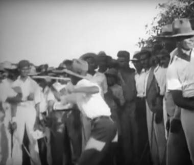

# Kalinda Stick Duel

*Kalinda / bois · Trinidad*

**Encyclopedia ID 1467** (permanent) · https://bpupadhyaya.github.io/world-heritage-games-site/games/1467-kalinda-stick-duel/

*Photo: Unknown author (1930s film still), [Public domain](https://creativecommons.org/publicdomain/mark/1.0/), [source on Wikimedia Commons](https://commons.wikimedia.org/wiki/File:1930s_Trinidad_Stick_Fighting.png)*

Two stick-fighters circle in a ring while drums set the beat; block, strike and dodge in time with the rhythm to win points.

## Heritage note

Part of the living heritage of Trinidad and Tobago. Some forms of this practice carry deep meaning for the communities who keep it; here we describe the play and the craft only, with respect for its roots.

## Origins

Usually placed in the era of Classical Worlds (about 1000 BCE to 500 CE), although its exact origins are uncertain, within the cultural world of The Americas: Caribbean.

## Facts

- **Where:** Trinidad and Tobago
- **Type:** Wrestling and martial sports
- **Family:** Tag, chase and hide games
- **Era:** [Classical Worlds](../../eras/classical/index.md) (uncertain)
- **Cradle:** [The Americas: Caribbean](../../cradles/caribbean/index.md)
- **Region:** Americas

## Related entries

- [Moraingy drum-and-strike duel](../../games/207-moraingy-drum-and-strike-duel/index.md)
- [Circle Dodgeball](../../games/470-circle-dodgeball/index.md)
- [Al Ayyala Cane-Line Rhythm](../../games/1272-al-ayyala-cane-line-rhythm/index.md)
- [Kyz Kuu](../../games/858-kyz-kuu/index.md)
- [Burn-out](../../games/654-burn-out/index.md)
- [Kho-Kho](../../games/15-kho-kho/index.md)

## Sources

- <https://commons.wikimedia.org/wiki/File:1930s_Trinidad_Stick_Fighting.png>
