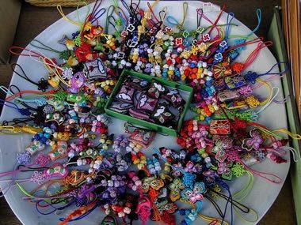

# Maedeup

*매듭 · Korean decorative knotting*

**Encyclopedia ID 1468** (permanent) · https://bpupadhyaya.github.io/world-heritage-games-site/games/1468-maedeup/

*Photo: SJ Yang, [CC BY-SA 2.0](https://creativecommons.org/licenses/by-sa/2.0/), [source on Wikimedia Commons](https://commons.wikimedia.org/wiki/File:Korean_knotting-Maedeup-01.jpg)*

Follow a pattern to fold and pull coloured cords through loops to form a symmetrical knot, then attach a tassel and hang it as an ornament.

## Heritage note

Part of the living heritage of South Korea.

## Origins

A living tradition passed from person to person; it is not tied to a single dated origin. It belongs to the cultural world of Japan and Korea.

## Facts

- **Where:** South Korea
- **Type:** Crafts and making
- **Family:** Paper, ink and painting crafts
- **Era:** [Living Traditions](../../eras/living/index.md)
- **Cradle:** [Japan and Korea](../../cradles/japan-korea/index.md)
- **Region:** East and Southeast Asia

## Related entries

- [Bojagi](../../games/363-bojagi/index.md)
- [Temari Thread-Ball Patterns](../../games/96-temari-thread-ball-patterns/index.md)
- [Kumiko lattice](../../games/97-kumiko-lattice/index.md)
- [Shibori Indigo Fold](../../games/106-shibori-indigo-fold/index.md)
- [Kumihimo Braid Disk](../../games/107-kumihimo-braid-disk/index.md)
- [Kokeshi doll painting](../../games/355-kokeshi-doll-painting/index.md)

## Sources

- <https://commons.wikimedia.org/wiki/File:Korean_knotting-Maedeup-01.jpg>
