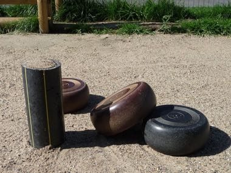

# Krulbol

*Krulbol / Rolle Bolle · Flemish Curve Bowls*

**Encyclopedia ID 1469** (permanent) · https://equalinformation.com/world-heritage-games-site/games/1469-krulbol/

*Photo: VlaS, [CC0](https://creativecommons.org/publicdomain/zero/1.0/), [source on Wikimedia Commons](https://commons.wikimedia.org/wiki/File:Staak_met_bollen.JPG)*

Roll a flat, off-centre disc so it curves around the lane and stops as close as possible to a stake, in teams.

## Heritage note

Part of the living heritage of Belgium, Netherlands.

## Origins

Usually placed in the era of Classical Worlds (about 1000 BCE to 500 CE), although its exact origins are uncertain, within the cultural world of Celtic and Atlantic Europe.

## Facts

- **Where:** Belgium, Netherlands
- **Type:** Dexterity and skill games
- **Family:** Archery and target games
- **Era:** [Classical Worlds](../../eras/classical/index.md) (uncertain)
- **Cradle:** [Celtic and Atlantic Europe](../../cradles/celtic-atlantic/index.md)
- **Region:** Europe

## Related entries

- [Lawn bowls](../../games/74-lawn-bowls/index.md)
- [Boules lyonnaises](../../games/730-boules-lyonnaises/index.md)
- [Provencal boules](../../games/939-provencal-boules/index.md)
- [Horseshoe pitching](../../games/50-horseshoe-pitching/index.md)
- [Mounted Archery Course](../../games/67-mounted-archery-course/index.md)
- [Mongolian Bow Archery](../../games/1476-mongolian-bow-archery/index.md)

## Sources

- <https://commons.wikimedia.org/wiki/File:Staak_met_bollen.JPG>
