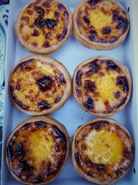

# Macau Portuguese Custard Tart Bake

*澳門葡撻*

**Encyclopedia ID 1471** (permanent) · https://bpupadhyaya.github.io/world-heritage-games-site/games/1471-macau-portuguese-custard-tart-bake/

*Photo: Pauloleong2002, [CC BY-SA 4.0](https://creativecommons.org/licenses/by-sa/4.0/), [source on Wikimedia Commons](https://commons.wikimedia.org/wiki/File:Portuguese_egg_tart_in_Macau.jpg)*

Press pastry into tins, pour in custard, set oven heat and timer so the tops caramelise perfectly into the signature dark-spotted, flaky, wobbly tarts.

## Heritage note

Part of the living heritage of Portugal, China.

## Origins

A living tradition passed from person to person; it is not tied to a single dated origin. It belongs to the cultural world of Mediterranean.

## Facts

- **Where:** Portugal, China
- **Type:** Crafts and making
- **Era:** [Living Traditions](../../eras/living/index.md)
- **Cradle:** [Mediterranean](../../cradles/mediterranean/index.md)
- **Region:** Europe

## Related entries

- [Azulejo tile painting](../../games/122-azulejo-tile-painting/index.md)
- [Zellij tile mosaic](../../games/21-zellij-tile-mosaic/index.md)
- [Glassblowing](../../games/121-glassblowing/index.md)
- [Lefkara Lace](../../games/220-lefkara-lace/index.md)
- [Amazigh Rug Weaving](../../games/224-amazigh-rug-weaving/index.md)
- [Txalaparta Duet](../../games/390-txalaparta-duet/index.md)

## Sources

- <https://commons.wikimedia.org/wiki/File:Portuguese_egg_tart_in_Macau.jpg>
