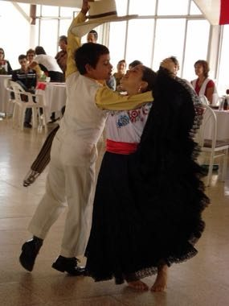

# Marinera Norteña

*Marinera norteña · handkerchief courtship dance*

**Encyclopedia ID 1472** (permanent) · https://bpupadhyaya.github.io/world-heritage-games-site/games/1472-marinera-nortena/

*Photo: Miguel Vera León from Santiago, Chile, [CC BY 2.0](https://creativecommons.org/licenses/by/2.0/), [source on Wikimedia Commons](https://commons.wikimedia.org/wiki/File:Marinera_Norte%C3%B1a_1.jpg)*

Two dancers flirt with waving handkerchiefs.

## Heritage note

Part of the living heritage of Peru.

## Origins

A living tradition passed from person to person; it is not tied to a single dated origin. It belongs to the cultural world of The Americas: Andes and South America.

## Facts

- **Where:** Peru
- **Type:** Dances
- **Family:** Folk and line dances
- **Era:** [Living Traditions](../../eras/living/index.md)
- **Cradle:** [The Americas: Andes and South America](../../cradles/andes-south-america/index.md)
- **Region:** Americas

## Related entries

- [Cueca](../../games/430-cueca/index.md)
- [Frevo Umbrella Dance](../../games/1411-frevo-umbrella-dance/index.md)
- [Malambo](../../games/1417-malambo/index.md)
- [Bottle Dance](../../games/1424-bottle-dance/index.md)
- [Dabke line dance](../../games/37-dabke-line-dance/index.md)
- [Gumboot dance rhythm](../../games/123-gumboot-dance-rhythm/index.md)

## Sources

- <https://commons.wikimedia.org/wiki/File:Marinera_Norte%C3%B1a_1.jpg>
