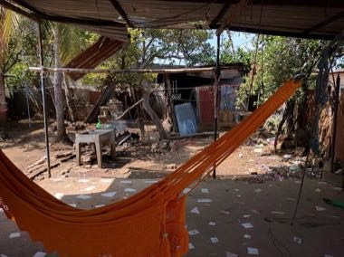

# Masaya Hammock Weaving

*Also known as: Hamaca de Masaya*

**Encyclopedia ID 1473** (permanent) · https://bpupadhyaya.github.io/world-heritage-games-site/games/1473-masaya-hammock-weaving/

*Photo: Eric Phelps, [CC BY 3.0](https://creativecommons.org/licenses/by/3.0/), [source on Wikimedia Commons](https://commons.wikimedia.org/wiki/File:Hammock_factory_-_panoramio.jpg)*

Pull cotton strands over a frame, knot the rows and choose colour stripes to weave a hammock, matching a customer's order.

## Heritage note

Part of the living heritage of Nicaragua.

## Origins

A living tradition passed from person to person; it is not tied to a single dated origin. It belongs to the cultural world of The Americas: Mesoamerica.

## Facts

- **Where:** Nicaragua
- **Type:** Crafts and making
- **Family:** Textile and weaving crafts
- **Era:** [Living Traditions](../../eras/living/index.md)
- **Cradle:** [The Americas: Mesoamerica](../../cradles/meso-america/index.md)
- **Region:** Americas

## Related entries

- [Kente strip weaving](../../games/22-kente-strip-weaving/index.md)
- [Celtic knot weave](../../games/25-celtic-knot-weave/index.md)
- [Sashiko Stitch Patterns](../../games/27-sashiko-stitch-patterns/index.md)
- [Adire indigo resist dyeing](../../games/87-adire-indigo-resist-dyeing/index.md)
- [Agaseke basket weaving](../../games/89-agaseke-basket-weaving/index.md)
- [Toquilla straw hat weaving](../../games/93-toquilla-straw-hat-weaving/index.md)

## Sources

- <https://commons.wikimedia.org/wiki/File:Hammock_factory_-_panoramio.jpg>
