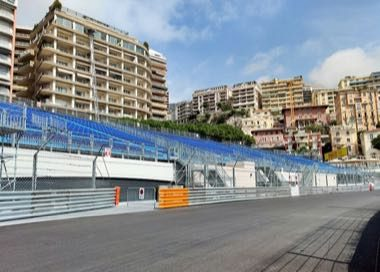

# Harbour Street Circuit Time Trial

*Circuit de la rade (generic)*

**Encyclopedia ID 1475** (permanent) · https://equalinformation.com/world-heritage-games-site/games/1475-harbour-street-circuit-time-trial/

*Photo: crash71100, [CC0](https://creativecommons.org/publicdomain/zero/1.0/), [source on Wikimedia Commons](https://commons.wikimedia.org/wiki/File:Circuit_de_Monaco_-_Sortie_du_virage_du_Tabac_(54783935639).jpg)*

Steer a small racing car around a tight harbour street course with barriers, tunnel and hairpin, braking and cornering to beat a ghost lap.

## Heritage note

Part of the living heritage of Monaco.

## Origins

Usually placed in the era of Modern Heritage (1800 to today), although its exact origins are uncertain, within the cultural world of Celtic and Atlantic Europe.

## Facts

- **Where:** Monaco
- **Type:** Racing
- **Family:** Winter sports
- **Era:** [Modern Heritage](../../eras/modern/index.md) (uncertain)
- **Cradle:** [Celtic and Atlantic Europe](../../cradles/celtic-atlantic/index.md)
- **Region:** Europe

## Related entries

- [Bagatelle](../../games/72-bagatelle/index.md)
- [Bat and Trap](../../games/405-bat-and-trap/index.md)
- [Bridge Stick Race](../../games/468-bridge-stick-race/index.md)
- [Curling](../../games/1181-curling/index.md)
- [Chinlone](../../games/16-chinlone/index.md)
- [Pinata swing](../../games/61-pinata-swing/index.md)

## Sources

- <https://commons.wikimedia.org/wiki/File:Circuit_de_Monaco_-_Sortie_du_virage_du_Tabac_(54783935639).jpg>
