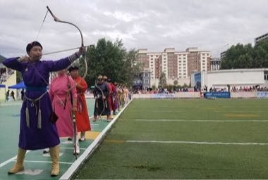

# Mongolian Bow Archery

*Also known as: сур харвах · sur harvaa*

**Encyclopedia ID 1476** (permanent) · https://bpupadhyaya.github.io/world-heritage-games-site/games/1476-mongolian-bow-archery/

*Photo: Orgio89, [CC BY-SA 4.0](https://creativecommons.org/licenses/by-sa/4.0/), [source on Wikimedia Commons](https://commons.wikimedia.org/wiki/File:20230712_Archery_contest_in_Mongolia_2.jpg)*

Draw a composite horn bow, adjust for wind and distance, and shoot at a row of small woven-leather cylinders stacked on a ground wall, scoring clearing cylinders.

## Heritage note

Part of the living heritage of Mongolia.

## Origins

Usually placed in the era of Classical Worlds (about 1000 BCE to 500 CE), although its exact origins are uncertain, within the cultural world of Steppe and Arctic.

## Facts

- **Where:** Mongolia
- **Type:** Dexterity and skill games
- **Family:** Archery and target games
- **Era:** [Classical Worlds](../../eras/classical/index.md) (uncertain)
- **Cradle:** [Steppe and Arctic](../../cradles/steppe-arctic/index.md)
- **Region:** East and Southeast Asia

## Related entries

- [Horseshoe pitching](../../games/50-horseshoe-pitching/index.md)
- [Mounted Archery Course](../../games/67-mounted-archery-course/index.md)
- [Lawn bowls](../../games/74-lawn-bowls/index.md)
- [Krulbol](../../games/1469-krulbol/index.md)
- [Archery](../../games/591-archery/index.md)
- [Boules lyonnaises](../../games/730-boules-lyonnaises/index.md)

## Sources

- <https://commons.wikimedia.org/wiki/File:20230712_Archery_contest_in_Mongolia_2.jpg>
