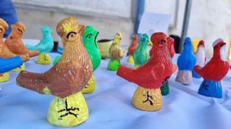

# Clay Bird Whistle Painting

*Also known as: Péckvillercher*

**Encyclopedia ID 1478** (permanent) · https://bpupadhyaya.github.io/world-heritage-games-site/games/1478-clay-bird-whistle-painting/

*Photo: GilPe, [CC BY-SA 4.0](https://creativecommons.org/licenses/by-sa/4.0/), [source on Wikimedia Commons](https://commons.wikimedia.org/wiki/File:Luxembourg,_Eemaischen_2022_-_P%C3%A9ckvillercher_(101).jpg)*

Mould and fire a small clay bird, paint its glaze in the traditional blue, white, green and red patterns, then blow it to match a short whistle tune.

## Heritage note

Part of the living heritage of Luxembourg. Some forms of this practice carry deep meaning for the communities who keep it; here we describe the play and the craft only, with respect for its roots.

## Origins

A living tradition passed from person to person; it is not tied to a single dated origin. It belongs to the cultural world of Celtic and Atlantic Europe.

## Facts

- **Where:** Luxembourg
- **Type:** Musical instruments
- **Family:** Wind instruments
- **Era:** [Living Traditions](../../eras/living/index.md)
- **Cradle:** [Celtic and Atlantic Europe](../../cradles/celtic-atlantic/index.md)
- **Region:** Europe

## Related entries

- [Khene](../../games/145-khene/index.md)
- [Mijwiz Double Clarinet](../../games/221-mijwiz-double-clarinet/index.md)
- [Mudhif reed-arch house](../../games/230-mudhif-reed-arch-house/index.md)
- [Lusheng](../../games/337-lusheng/index.md)
- [Launeddas Triple Pipe](../../games/400-launeddas-triple-pipe/index.md)
- [Vallenato accordion trio](../../games/431-vallenato-accordion-trio/index.md)

## Sources

- <https://commons.wikimedia.org/wiki/File:Luxembourg,_Eemaischen_2022_-_P%C3%A9ckvillercher_(101).jpg>
