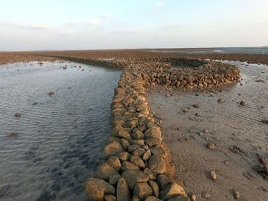

# Penghu Stone Weir Tide Puzzle

*Also known as: 澎湖石滬*

**Encyclopedia ID 1479** (permanent) · https://bpupadhyaya.github.io/world-heritage-games-site/games/1479-penghu-stone-weir-tide-puzzle/

*Photo: 曾宥輯, [CC BY-SA 4.0](https://creativecommons.org/licenses/by-sa/4.0/), [source on Wikimedia Commons](https://commons.wikimedia.org/wiki/File:%E6%BE%8E%E6%B9%96%E7%9F%B3%E6%BB%AC_1.jpg)*

Stack basalt and coral stones into heart- or crescent-shaped tidal weirs, then watch the tide ebb and flood to trap fish; better wall shapes catch more.

## Heritage note

Part of the living heritage of Taiwan. Some forms of this practice carry deep meaning for the communities who keep it; here we describe the play and the craft only, with respect for its roots.

## Origins

A living tradition passed from person to person; it is not tied to a single dated origin. It belongs to the cultural world of Southeast Asia and the Islands.

## Facts

- **Where:** Taiwan
- **Type:** Crafts and making
- **Era:** [Living Traditions](../../eras/living/index.md)
- **Cradle:** [Southeast Asia and the Islands](../../cradles/southeast-asia/index.md)
- **Region:** East and Southeast Asia

## Related entries

- [Greasy pole climb](../../games/77-greasy-pole-climb/index.md)
- [Batik wax-resist pattern studio](../../games/105-batik-wax-resist-pattern-studio/index.md)
- [Thai fruit and vegetable carving](../../games/114-thai-fruit-and-vegetable-carving/index.md)
- [Angklung bamboo chime ensemble](../../games/142-angklung-bamboo-chime-ensemble/index.md)
- [Dan bau](../../games/143-dan-bau/index.md)
- [Khene](../../games/145-khene/index.md)

## Sources

- <https://commons.wikimedia.org/wiki/File:%E6%BE%8E%E6%B9%96%E7%9F%B3%E6%BB%AC_1.jpg>
