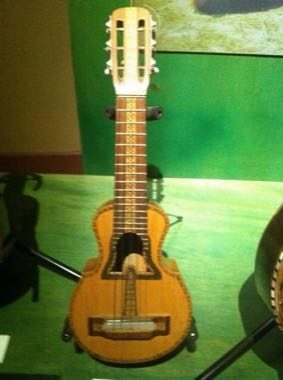

# Puerto Rican Cuatro

*Cuatro*

**Encyclopedia ID 1481** (permanent) · https://bpupadhyaya.github.io/world-heritage-games-site/games/1481-puerto-rican-cuatro/

*Photo: Caballero1967, [CC BY-SA 4.0](https://creativecommons.org/licenses/by-sa/4.0/), [source on Wikimedia Commons](https://commons.wikimedia.org/wiki/File:Cuatro_puertorriqueño,_modelo_histórico.JPG)*

Strum and pluck the ten-string cuatro in time with the beat as the notes scroll, matching chords and melodic runs.

## Heritage note

A tradition shared by communities in many places.

## Origins

A living tradition passed from person to person; it is not tied to a single dated origin.

## Facts

- **Where:** Shared across many places
- **Type:** Musical instruments
- **Family:** String instruments
- **Era:** [Living Traditions](../../eras/living/index.md)
- **Cradle:** [Shared across the world](../../cradles/worldwide/index.md)
- **Region:** Americas

## Related entries

- [Santur Hammer Strings](../../games/138-santur-hammer-strings/index.md)
- [Dan bau](../../games/143-dan-bau/index.md)
- [Santoor](../../games/151-santoor/index.md)
- [Goje One-String Fiddle](../../games/176-goje-one-string-fiddle/index.md)
- [Masenqo and the azmari](../../games/187-masenqo-and-the-azmari/index.md)
- [Hira gasy village troupe contest](../../games/205-hira-gasy-village-troupe-contest/index.md)

## Sources

- <https://commons.wikimedia.org/wiki/File:Cuatro_puertorriqueño,_modelo_histórico.JPG>
