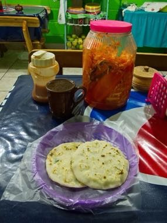

# Pupusa Maker

*Pupusa · hand-patted stuffed tortillas*

**Encyclopedia ID 1482** (permanent) · https://equalinformation.com/world-heritage-games-site/games/1482-pupusa-maker/

*Photo: Ll1324, [CC0](https://creativecommons.org/publicdomain/zero/1.0/), [source on Wikimedia Commons](https://commons.wikimedia.org/wiki/File:Typical_serving_of_Pupusas_in_El_Salvador.jpg)*

Pat out masa, stuff it with beans, cheese or pork, seal and griddle it, then top plates with curtido and salsa for the queue of customers.

## Heritage note

Part of the living heritage of El Salvador.

## Origins

A living tradition passed from person to person; it is not tied to a single dated origin. It belongs to the cultural world of The Americas: Mesoamerica.

## Facts

- **Where:** El Salvador
- **Type:** Crafts and making
- **Era:** [Living Traditions](../../eras/living/index.md)
- **Cradle:** [The Americas: Mesoamerica](../../cradles/meso-america/index.md)
- **Region:** Americas

## Related entries

- [Alebrije painting](../../games/92-alebrije-painting/index.md)
- [Costa Rican painted oxcart](../../games/427-costa-rican-painted-oxcart/index.md)
- [Talavera tile painting](../../games/429-talavera-tile-painting/index.md)
- [Baleada Stand](../../games/1436-baleada-stand/index.md)
- [Chinampa Gardens](../../games/1444-chinampa-gardens/index.md)
- [Chorreador](../../games/1446-chorreador/index.md)

## Sources

- <https://commons.wikimedia.org/wiki/File:Typical_serving_of_Pupusas_in_El_Salvador.jpg>
