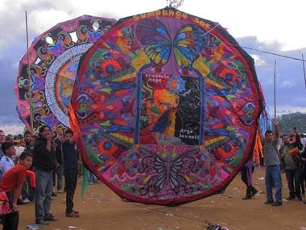

# Giant Barriletes

*Barriletes gigantes · Sumpango kites*

**Encyclopedia ID 1486** (permanent) · https://equalinformation.com/world-heritage-games-site/games/1486-giant-barriletes/

*Photo: SantiagoGG, [CC BY-SA 4.0](https://creativecommons.org/licenses/by-sa/4.0/), [source on Wikimedia Commons](https://commons.wikimedia.org/wiki/File:Festival_Barriletes_en_Sumpango_Detalle.jpg)*

Design a big coloured tissue-paper kite on a bamboo frame, balance it, then fly it in wind without tearing.

## Heritage note

Part of the living heritage of Guatemala. Some forms of this practice carry deep meaning for the communities who keep it; here we describe the play and the craft only, with respect for its roots.

## Origins

A living tradition passed from person to person; it is not tied to a single dated origin. It belongs to the cultural world of The Americas: Mesoamerica.

## Facts

- **Where:** Guatemala
- **Type:** Crafts and making
- **Family:** Paper, ink and painting crafts
- **Era:** [Living Traditions](../../eras/living/index.md)
- **Cradle:** [The Americas: Mesoamerica](../../cradles/meso-america/index.md)
- **Region:** Americas

## Related entries

- [Alebrije painting](../../games/92-alebrije-painting/index.md)
- [Costa Rican painted oxcart](../../games/427-costa-rican-painted-oxcart/index.md)
- [Pollera and Tembleques](../../games/1480-pollera-and-tembleques/index.md)
- [Ebru paper marbling](../../games/20-ebru-paper-marbling/index.md)
- [Ndebele geometric wall painting](../../games/23-ndebele-geometric-wall-painting/index.md)
- [Chinese knotting](../../games/26-chinese-knotting/index.md)

## Sources

- <https://commons.wikimedia.org/wiki/File:Festival_Barriletes_en_Sumpango_Detalle.jpg>
