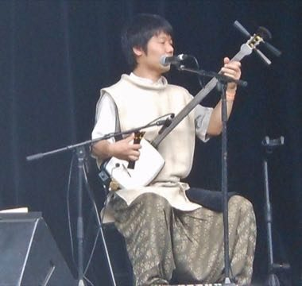

# Tsugaru Shamisen

*津軽三味線*

**Encyclopedia ID 1489** (permanent) · https://equalinformation.com/world-heritage-games-site/games/1489-tsugaru-shamisen/

*Photo: Michael Coghlan from Adelaide, Australia, [CC BY-SA 2.0](https://creativecommons.org/licenses/by-sa/2.0/), [source on Wikimedia Commons](https://commons.wikimedia.org/wiki/File:Tsugaru-shamisen_(8564059094).jpg)*

Strike and pluck three strings with a large plectrum (bachi) on a drum-skinned lute, hitting accents in rapid, percussive folk phrases.

## Heritage note

Part of the living heritage of Japan.

## Origins

Usually placed in the era of Crossroads and Golden Ages (about 500 to 1500), although its exact origins are uncertain, within the cultural world of Japan and Korea.

## Facts

- **Where:** Japan
- **Type:** Musical instruments
- **Family:** String instruments
- **Era:** [Crossroads and Golden Ages](../../eras/crossroads/index.md) (uncertain)
- **Cradle:** [Japan and Korea](../../cradles/japan-korea/index.md)
- **Region:** East and Southeast Asia

## Related entries

- [Dombra](../../games/48-dombra/index.md)
- [Charango](../../games/55-charango/index.md)
- [Erhu Two-String Fiddle](../../games/139-erhu-two-string-fiddle/index.md)
- [Buzuq Long-Neck Lute](../../games/218-buzuq-long-neck-lute/index.md)
- [Komuz](../../games/242-komuz/index.md)
- [Saz / Bağlama](../../games/243-saz-baglama/index.md)

## Sources

- <https://commons.wikimedia.org/wiki/File:Tsugaru-shamisen_(8564059094).jpg>
