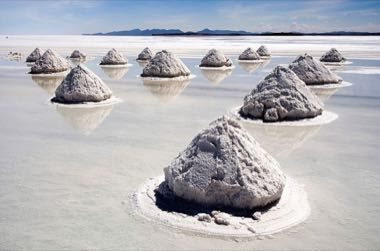

# Uyuni Salt Harvest

*Cosecha de sal en el Salar de Uyuni · salt-flat caravan*

**Encyclopedia ID 1491** (permanent) · https://bpupadhyaya.github.io/world-heritage-games-site/games/1491-uyuni-salt-harvest/

*Photo: Luca Galuzzi (Lucag), edit by Trialsanderrors, [CC BY-SA 2.5](https://creativecommons.org/licenses/by-sa/2.5/), [source on Wikimedia Commons](https://commons.wikimedia.org/wiki/File:Piles_of_Salt_Salar_de_Uyuni_Bolivia_Luca_Galuzzi_2006_a.jpg)*

Rake and pile the salt crust into cones to dry, load the llama caravan and plan the route across the flat before the weather changes.

## Heritage note

Part of the living heritage of Bolivia.

## Origins

Usually placed in the era of Modern Heritage (1800 to today), although its exact origins are uncertain, within the cultural world of The Americas: Andes and South America.

## Facts

- **Where:** Bolivia
- **Type:** Puzzles and mind games
- **Family:** Puzzle and dexterity toys
- **Era:** [Modern Heritage](../../eras/modern/index.md) (uncertain)
- **Cradle:** [The Americas: Andes and South America](../../cradles/andes-south-america/index.md)
- **Region:** Americas

## Related entries

- [Sapo](../../games/1019-sapo/index.md)
- [Atarraya](../../games/1434-atarraya/index.md)
- [Emboque](../../games/629-emboque/index.md)
- [Rana](../../games/645-rana/index.md)
- [Frog toss](../../games/688-frog-toss/index.md)
- [Perinola](../../games/1212-perinola/index.md)

## Sources

- <https://commons.wikimedia.org/wiki/File:Piles_of_Salt_Salar_de_Uyuni_Bolivia_Luca_Galuzzi_2006_a.jpg>
