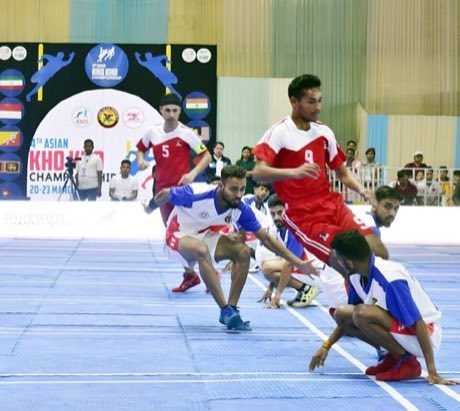

# Kho-Kho

*खो-खो · chain chase*

**Encyclopedia ID 15** (permanent) · https://bpupadhyaya.github.io/world-heritage-games-site/games/15-kho-kho/

*Photo: Khokhofederation, [CC BY-SA 4.0](https://creativecommons.org/licenses/by-sa/4.0/), [source on Wikimedia Commons](https://commons.wikimedia.org/wiki/File:Glimpse_of_India_vs_Nepal_Match_during_4th_Asian_Kho_Kho_Championship.jpg)*

Chasers sit in a row facing alternating directions.

## Heritage note

Part of the living heritage of India, Nepal, Bangladesh.

## Origins

Usually placed in the era of Modern Heritage (1800 to today), although its exact origins are uncertain, within the cultural world of South Asia.

## Facts

- **Where:** India, Nepal, Bangladesh, Sri Lanka
- **Type:** Street and playground games
- **Family:** Tag, chase and hide games
- **Era:** [Modern Heritage](../../eras/modern/index.md) (uncertain)
- **Cradle:** [South Asia](../../cradles/south-asia/index.md)
- **Region:** South and Central Asia

## Related entries

- [Gollachut](../../games/573-gollachut/index.md)
- [Kabaddi](../../games/789-kabaddi/index.md)
- [Stick game](../../games/912-stick-game/index.md)
- [Bashi](../../games/915-bashi/index.md)
- [Cheese Rolling Hill](../../games/70-cheese-rolling-hill/index.md)
- [Otedama](../../games/131-otedama/index.md)

## Sources

- <https://commons.wikimedia.org/wiki/File:Glimpse_of_India_vs_Nepal_Match_during_4th_Asian_Kho_Kho_Championship.jpg>
