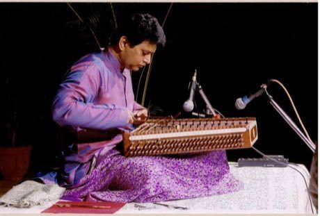

# Santoor

*Also known as: سنتور · hammered dulcimer*

**Encyclopedia ID 151** (permanent) · https://bpupadhyaya.github.io/world-heritage-games-site/games/151-santoor/

*Photo: Madan Oak, [CC BY-SA 3.0](https://creativecommons.org/licenses/by-sa/3.0/), [source on Wikimedia Commons](https://commons.wikimedia.org/wiki/File:Madan_Oak_Santoor_1.jpg)*

Strike strings with two light mallets on a trapezoid to match falling notes and play scales and folk tunes, with the sound ringing out.

## Heritage note

Part of the living heritage of India.

## Origins

A living tradition passed from person to person; it is not tied to a single dated origin. It belongs to the cultural world of South Asia.

## Facts

- **Where:** India
- **Type:** Musical instruments
- **Family:** String instruments
- **Era:** [Living Traditions](../../eras/living/index.md)
- **Cradle:** [South Asia](../../cradles/south-asia/index.md)
- **Region:** South and Central Asia

## Related entries

- [Kathputli string puppets](../../games/79-kathputli-string-puppets/index.md)
- [Santur Hammer Strings](../../games/138-santur-hammer-strings/index.md)
- [Dan bau](../../games/143-dan-bau/index.md)
- [Goje One-String Fiddle](../../games/176-goje-one-string-fiddle/index.md)
- [Masenqo and the azmari](../../games/187-masenqo-and-the-azmari/index.md)
- [Hira gasy village troupe contest](../../games/205-hira-gasy-village-troupe-contest/index.md)

## Sources

- <https://commons.wikimedia.org/wiki/File:Madan_Oak_Santoor_1.jpg>
