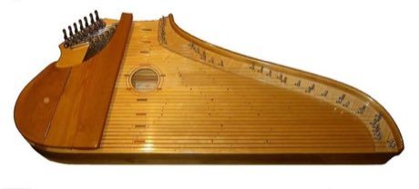

# Kantele

*Also known as: Finnish plucked zither*

**Encyclopedia ID 152** (permanent) · https://bpupadhyaya.github.io/world-heritage-games-site/games/152-kantele/

*Photo: Paul Lenz, [CC BY-SA 3.0](https://creativecommons.org/licenses/by-sa/3.0/), [source on Wikimedia Commons](https://commons.wikimedia.org/wiki/Concert_kantele.jpg)*

Pluck the glowing strings in order as notes drift down, then improvise freely on a five-string diatonic board.

## Heritage note

Part of the living heritage of Finland.

## Origins

Usually placed in the era of Classical Worlds (about 1000 BCE to 500 CE), although its exact origins are uncertain, within the cultural world of Northern and Eastern Europe.

## Facts

- **Where:** Finland
- **Type:** Musical instruments
- **Family:** String instruments
- **Era:** [Classical Worlds](../../eras/classical/index.md) (uncertain)
- **Cradle:** [Northern and Eastern Europe](../../cradles/north-east-europe/index.md)
- **Region:** Europe

## Related entries

- [String Marionette Theatre](../../games/68-string-marionette-theatre/index.md)
- [Kanklės](../../games/136-kankles/index.md)
- [Nyckelharpa](../../games/408-nyckelharpa/index.md)
- [Langeleik](../../games/1322-langeleik/index.md)
- [Morin khuur](../../games/34-morin-khuur/index.md)
- [Kathputli string puppets](../../games/79-kathputli-string-puppets/index.md)

## Sources

- <https://commons.wikimedia.org/wiki/Concert_kantele.jpg>
