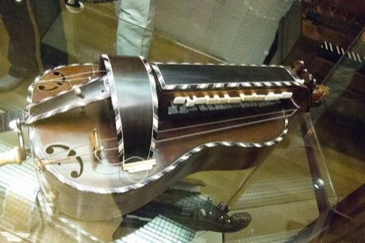

# Hurdy-gurdy

*Also known as: Vielle a roue*

**Encyclopedia ID 153** (permanent) · https://bpupadhyaya.github.io/world-heritage-games-site/games/153-hurdy-gurdy/

*Photo: Thomas Quine, [CC BY 2.0](https://creativecommons.org/licenses/by/2.0/), [source on Wikimedia Commons](https://commons.wikimedia.org/wiki/Hurdy_Gurdy_1,_MIM_Berlin.jpg)*

Turn the crank for a continuous drone while pressing the keys on time to play the tune and the buzzing trompette beat.

## Heritage note

Part of the living heritage of France.

## Origins

A living tradition passed from person to person; it is not tied to a single dated origin. It belongs to the cultural world of Celtic and Atlantic Europe.

## Facts

- **Where:** France
- **Type:** Musical instruments
- **Era:** [Living Traditions](../../eras/living/index.md)
- **Cradle:** [Celtic and Atlantic Europe](../../cradles/celtic-atlantic/index.md)
- **Region:** Europe

## Related entries

- [Dots and Boxes](../../games/463-dots-and-boxes/index.md)
- [Grandmother's Footsteps](../../games/469-grandmothers-footsteps/index.md)
- [Ribbon-Pole Plaiting Dance](../../games/512-ribbon-pole-plaiting-dance/index.md)
- [Filet lace](../../games/2318-filet-lace/index.md)
- [Aubusson tapestry](../../games/10370-aubusson-tapestry/index.md)
- [Vannerie sur arceaux](../../games/13768-vannerie-sur-arceaux/index.md)

## Sources

- <https://commons.wikimedia.org/wiki/Hurdy_Gurdy_1,_MIM_Berlin.jpg>
