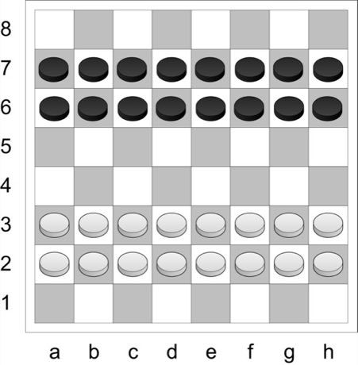

# Turkish Dama

*Dama · Turkish draughts · Türk daması · Dama (draughts) · Dama / Dama oyunu*

**Encyclopedia ID 155** (permanent) · https://bpupadhyaya.github.io/world-heritage-games-site/games/155-turkish-dama/

*Photo: Daryona, [CC BY-SA 3.0](https://creativecommons.org/licenses/by-sa/3.0/), [source on Wikimedia Commons](https://commons.wikimedia.org/wiki/File:Turkish_draughts.jpg)*

Sixteen men per side start on the second and third ranks; pieces step forward or sideways, capture by jumping orthogonally (never diagonally), must take the maximum capture, and promoted kings fly the length of the...

## How it is played

Sixteen men per side start on the second and third ranks; pieces step forward or sideways, capture by jumping orthogonally (never diagonally), must take the maximum capture, and promoted kings fly the length of the board.

## Heritage note

Part of the living heritage of Turkey.

## Origins

Usually placed in the era of Crossroads and Golden Ages (about 500 to 1500), although its exact origins are uncertain, within the cultural world of Mesopotamia, Levant and Arabia.

## Facts

- **Where:** Turkey, Turkmenistan, Ethiopia, Eritrea, Iraq, Syria, Lebanon
- **Type:** Board and table games
- **Family:** Draughts and capture games
- **Era:** [Crossroads and Golden Ages](../../eras/crossroads/index.md) (uncertain)
- **Cradle:** [Mesopotamia, Levant and Arabia](../../cradles/mesopotamia-levant/index.md)
- **Region:** Middle East and North Africa
- **Players:** 2

## Related entries

- [Yote Capture Grid](../../games/167-yote-capture-grid/index.md)
- [Peralikatuma](../../games/287-peralikatuma/index.md)
- [Kharbaga](../../games/459-kharbaga/index.md)
- [Sholo Guti](../../games/461-sholo-guti/index.md)
- [Zamma](../../games/462-zamma/index.md)
- [Queah](../../games/885-queah/index.md)

## Sources

- <https://commons.wikimedia.org/wiki/File:Turkish_draughts.jpg>
- <https://en.wikipedia.org/wiki/Turkish_draughts>
- <https://www.mindsports.nl/index.php/arena/draughts/502-dama-turkish-draughts>
- <https://en.wikipedia.org/wiki/Draughts>
- <https://gamesindustryafrica.com/2023/05/10/ethiopian-fit-jaktech-brings-popular-checkers-game-to-google-playstore/>
- <https://checkers.fandom.com/wiki/Dama>
