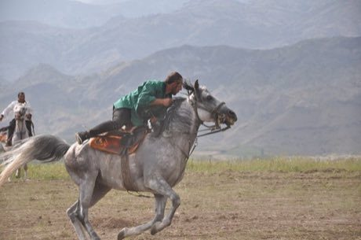

# Cirit

*Also known as: horseback javelin game*

**Encyclopedia ID 156** (permanent) · https://bpupadhyaya.github.io/world-heritage-games-site/games/156-cirit/

*Photo: Karagozerkan, [CC BY-SA 4.0](https://creativecommons.org/licenses/by-sa/4.0/), [source on Wikimedia Commons](https://commons.wikimedia.org/wiki/File:Cirit%C3%A7iler.jpg)*

Two mounted teams gallop across a field; a rider charges, hurls a blunt wooden javelin at an opponent, then wheels away before being hit in return.

## Heritage note

Part of the living heritage of Turkey. Animals are partners in this tradition; good care and local rules always come first.

## Origins

Usually placed in the era of Classical Worlds (about 1000 BCE to 500 CE), although its exact origins are uncertain, within the cultural world of Mesopotamia, Levant and Arabia.

## Facts

- **Where:** Turkey
- **Type:** Dexterity and skill games
- **Family:** Horse and animal sports
- **Era:** [Classical Worlds](../../eras/classical/index.md) (uncertain)
- **Cradle:** [Mesopotamia, Levant and Arabia](../../cradles/mesopotamia-levant/index.md)
- **Region:** Middle East and North Africa

## Play it

[Try a 90-second preview in your browser](https://bpupadhyaya.github.io/games-site/games/cirit/play/) · [Google Play](https://play.google.com/store/apps/details?id=com.equalinformation.arcforge.shell) · [App Store](https://apps.apple.com/us/app/arcforge-world-heritage-games/id6813746442)

## Related entries

- [Pato](../../games/420-pato/index.md)
- [Slovene quintain](../../games/1073-slovene-quintain/index.md)
- [Champ de Mars turf](../../games/1253-champ-de-mars-turf/index.md)
- [Encang kuda](../../games/1067-encang-kuda/index.md)
- [Turkmen Akhal-Teke equestrian games](../../games/1170-turkmen-akhal-teke-equestrian-games/index.md)
- [Chavgon](../../games/1204-chavgon/index.md)

## Sources

- <https://commons.wikimedia.org/wiki/File:Cirit%C3%A7iler.jpg>
