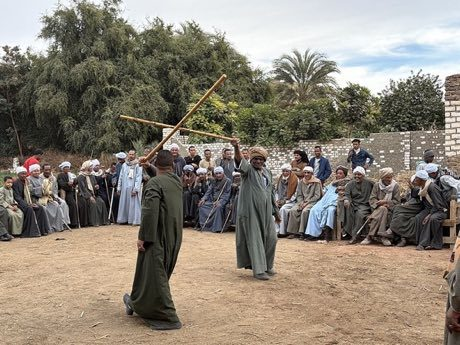

# Tahtib

*Also known as: Egyptian stick dance-duel*

**Encyclopedia ID 157** (permanent) · https://bpupadhyaya.github.io/world-heritage-games-site/games/157-tahtib/

*Photo: ولاء, [Public domain](https://creativecommons.org/publicdomain/mark/1.0/), [source on Wikimedia Commons](https://commons.wikimedia.org/wiki/File:Tahtib,_Mawlid_Al-Ashi,_Luxor_05.jpg)*

Two players face off with long wooden staffs in a stylised duel of timed strikes and blocks that stays a graceful dance with no real hits.

## Heritage note

Part of the living heritage of Egypt.

## Origins

A living tradition passed from person to person; it is not tied to a single dated origin. It belongs to the cultural world of Africa: Nile and the Horn.

## Facts

- **Where:** Egypt
- **Type:** Dances
- **Family:** Folk and line dances
- **Era:** [Living Traditions](../../eras/living/index.md)
- **Cradle:** [Africa: Nile and the Horn](../../cradles/africa-nile/index.md)
- **Region:** Middle East and North Africa

## Related entries

- [Eskista](../../games/188-eskista/index.md)
- [Jebena coffee brewing](../../games/189-jebena-coffee-brewing/index.md)
- [Dabke line dance](../../games/37-dabke-line-dance/index.md)
- [Gumboot dance rhythm](../../games/123-gumboot-dance-rhythm/index.md)
- [Cueca](../../games/430-cueca/index.md)
- [Faroese chain dance](../../games/1276-faroese-chain-dance/index.md)

## Sources

- <https://commons.wikimedia.org/wiki/File:Tahtib,_Mawlid_Al-Ashi,_Luxor_05.jpg>
