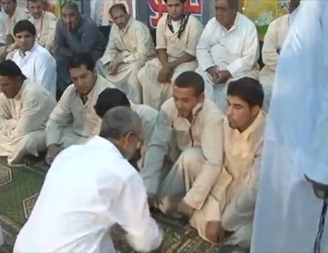

# Mheibes

*Also known as: Muhaibis · Hunt the Ring*

**Encyclopedia ID 158** (permanent) · https://bpupadhyaya.github.io/world-heritage-games-site/games/158-mheibes/

*Photo: Sinan Saeed, [CC BY 3.0](https://creativecommons.org/licenses/by/3.0/), [source on Wikimedia Commons](https://commons.wikimedia.org/wiki/File:Mheibes_decision.jpg)*

One team hides a ring in one of its members' fists; the opposing captain studies faces and gestures and points to eliminate hands until the ring is found, earning or losing counters.

## Heritage note

Part of the living heritage of Iraq.

## Origins

Usually placed in the era of Modern Heritage (1800 to today), although its exact origins are uncertain, within the cultural world of Mesopotamia, Levant and Arabia.

## Facts

- **Where:** Iraq
- **Type:** Street and playground games
- **Family:** Hunt and blockade games
- **Era:** [Modern Heritage](../../eras/modern/index.md) (uncertain)
- **Cradle:** [Mesopotamia, Levant and Arabia](../../cradles/mesopotamia-levant/index.md)
- **Region:** Middle East and North Africa

## Related entries

- [Steppe eagle hunting](../../games/254-steppe-eagle-hunting/index.md)
- [Al-Jazari water-clock contraptions](../../games/237-al-jazari-water-clock-contraptions/index.md)
- [Kok-boru](../../games/241-kok-boru/index.md)
- [Blind Man's Buff](../../games/467-blind-mans-buff/index.md)
- [Hama Noria Waterwheels](../../games/1295-hama-noria-waterwheels/index.md)
- [Phoenician Alphabet Trader](../../games/1359-phoenician-alphabet-trader/index.md)

## Sources

- <https://commons.wikimedia.org/wiki/File:Mheibes_decision.jpg>
