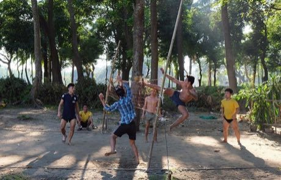

# Chinlone

*ချင်းလုံး · Caneball · cane-ball circle dance*

**Encyclopedia ID 16** (permanent) · https://bpupadhyaya.github.io/world-heritage-games-site/games/16-chinlone/

*Photo: kallerna, [CC BY-SA 4.0](https://creativecommons.org/licenses/by-sa/4.0/), [source on Wikimedia Commons](https://commons.wikimedia.org/wiki/File:Chinlone_Kandawgyi_park.jpg)*

A circle of six players keeps a woven cane ball aloft with feet, knees, heels and heads, passing it in graceful, choreographed moves with no winner or loser.

## Heritage note

Part of the living heritage of Myanmar. Some forms of this practice carry deep meaning for the communities who keep it; here we describe the play and the craft only, with respect for its roots.

## Origins

Usually placed in the era of Modern Heritage (1800 to today), although its exact origins are uncertain, within the cultural world of Southeast Asia and the Islands.

## Facts

- **Where:** Myanmar
- **Type:** Dexterity and skill games
- **Family:** Winter sports
- **Era:** [Modern Heritage](../../eras/modern/index.md) (uncertain)
- **Cradle:** [Southeast Asia and the Islands](../../cradles/southeast-asia/index.md)
- **Region:** East and Southeast Asia
- **Players:** 6

## Related entries

- [Pinata swing](../../games/61-pinata-swing/index.md)
- [Ring Tilting](../../games/65-ring-tilting/index.md)
- [Yukigassen Snow Fort](../../games/71-yukigassen-snow-fort/index.md)
- [Bagatelle](../../games/72-bagatelle/index.md)
- [Plate Spinning](../../games/73-plate-spinning/index.md)
- [Nguni stick-fighting rhythm skirmish](../../games/209-nguni-stick-fighting-rhythm-skirmish/index.md)

## Sources

- <https://commons.wikimedia.org/wiki/File:Chinlone_Kandawgyi_park.jpg>
- <https://en.wikipedia.org/wiki/Chinlone>
- <https://myanmar-now.org/en/news/ancient-myanmar-ball-game-battles-for-survival-in-troubled-nation/>
