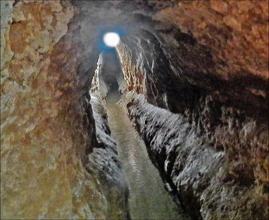

# Qanat Water Tunnels

*قنات*

**Encyclopedia ID 160** (permanent) · https://bpupadhyaya.github.io/world-heritage-games-site/games/160-qanat-water-tunnels/

*Photo: NAEINSUN, [CC BY-SA 4.0](https://creativecommons.org/licenses/by-sa/4.0/), [source on Wikimedia Commons](https://commons.wikimedia.org/wiki/File:L%E2%80%99int%C3%A9rieur_d%E2%80%99un_qanat_en_iran.jpg)*

Dig and connect sloped underground channels from a mountain aquifer to a village while avoiding collapses, sharing water between fields and orchards.

## Heritage note

Part of the living heritage of Iran. Some forms of this practice carry deep meaning for the communities who keep it; here we describe the play and the craft only, with respect for its roots.

## Origins

Usually placed in the era of Modern Heritage (1800 to today), although its exact origins are uncertain, within the cultural world of Persia, Caucasus and Central Asia.

## Facts

- **Where:** Iran
- **Type:** Puzzles and mind games
- **Family:** Puzzle and dexterity toys
- **Era:** [Modern Heritage](../../eras/modern/index.md) (uncertain)
- **Cradle:** [Persia, Caucasus and Central Asia](../../cradles/persia-central-asia/index.md)
- **Region:** Middle East and North Africa

## Related entries

- [Astrolabe: reading the sky](../../games/236-astrolabe-reading-the-sky/index.md)
- [Asyk Atu](../../games/856-asyk-atu/index.md)
- [Alchik](../../games/868-alchik/index.md)
- [Ordo](../../games/870-ordo/index.md)
- [Ashyk](../../games/1169-ashyk/index.md)
- [Kingyo-sukui](../../games/3-kingyo-sukui/index.md)

## Sources

- <https://commons.wikimedia.org/wiki/File:L%E2%80%99int%C3%A9rieur_d%E2%80%99un_qanat_en_iran.jpg>
