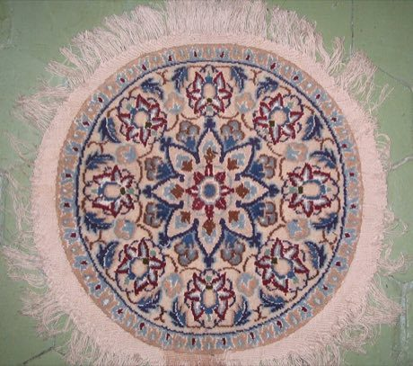

# Persian Carpet Knotting

*Also known as: فرش دستباف*

**Encyclopedia ID 161** (permanent) · https://bpupadhyaya.github.io/world-heritage-games-site/games/161-persian-carpet-knotting/

*Photo: Fabienkhan, [CC BY-SA 3.0](https://creativecommons.org/licenses/by-sa/3.0/), [source on Wikimedia Commons](https://commons.wikimedia.org/wiki/File:Nain_rug.jpg)*

Colour in a knot-by-knot grid to weave medallion, boteh and garden patterns, matching a traditional design before the wool runs out.

## Heritage note

Part of the living heritage of Iran, Turkey. Some forms of this practice carry deep meaning for the communities who keep it; here we describe the play and the craft only, with respect for its roots.

## Origins

A living tradition passed from person to person; it is not tied to a single dated origin. It belongs to the cultural world of Persia, Caucasus and Central Asia.

## Facts

- **Where:** Iran, Turkey
- **Type:** Crafts and making
- **Family:** Textile and weaving crafts
- **Era:** [Living Traditions](../../eras/living/index.md)
- **Cradle:** [Persia, Caucasus and Central Asia](../../cradles/persia-central-asia/index.md)
- **Region:** Middle East and North Africa

## Related entries

- [Ikat Pattern Dyeing](../../games/104-ikat-pattern-dyeing/index.md)
- [Suzani embroidery](../../games/248-suzani-embroidery/index.md)
- [Turkmen gul carpet](../../games/249-turkmen-gul-carpet/index.md)
- [Kente strip weaving](../../games/22-kente-strip-weaving/index.md)
- [Celtic knot weave](../../games/25-celtic-knot-weave/index.md)
- [Sashiko Stitch Patterns](../../games/27-sashiko-stitch-patterns/index.md)

## Sources

- <https://commons.wikimedia.org/wiki/File:Nain_rug.jpg>
