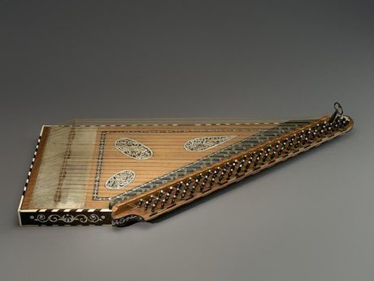

# Qanun

*Also known as: قانون · plucked trapezoid zither*

**Encyclopedia ID 162** (permanent) · https://bpupadhyaya.github.io/world-heritage-games-site/games/162-qanun/

*Photo: Metropolitan Museum of Art, [CC0](https://creativecommons.org/publicdomain/zero/1.0/), [source on Wikimedia Commons](https://commons.wikimedia.org/wiki/File:Q%C4%81n%C5%ABn_-_MET_89.4.330.jpg)*

Players pluck the strings with fingerpicks and flick the small levers beside each course to reach quarter-tone notes in Arabic and Turkish melodies.

## Heritage note

Part of the living heritage of Turkey, Armenia, Azerbaijan.

## Origins

Usually placed in the era of Classical Worlds (about 1000 BCE to 500 CE), although its exact origins are uncertain, within the cultural world of Mesopotamia, Levant and Arabia.

## Facts

- **Where:** Turkey, Armenia, Azerbaijan
- **Type:** Musical instruments
- **Family:** String instruments
- **Era:** [Classical Worlds](../../eras/classical/index.md) (uncertain)
- **Cradle:** [Mesopotamia, Levant and Arabia](../../cradles/mesopotamia-levant/index.md)
- **Region:** Middle East and North Africa

## Related entries

- [Morin khuur](../../games/34-morin-khuur/index.md)
- [Kathputli string puppets](../../games/79-kathputli-string-puppets/index.md)
- [Valiha tube zither](../../games/124-valiha-tube-zither/index.md)
- [Krar lyre](../../games/126-krar-lyre/index.md)
- [Joropo llanero band](../../games/130-joropo-llanero-band/index.md)
- [Kanklės](../../games/136-kankles/index.md)

## Sources

- <https://commons.wikimedia.org/wiki/File:Q%C4%81n%C5%ABn_-_MET_89.4.330.jpg>
