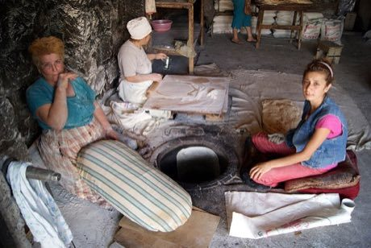

# Lavash Baking

*Լավաշ · tonir*

**Encyclopedia ID 163** (permanent) · https://equalinformation.com/world-heritage-games-site/games/163-lavash-baking/

*Photo: Armineaghayan, [CC BY-SA 4.0](https://creativecommons.org/licenses/by-sa/4.0/), [source on Wikimedia Commons](https://commons.wikimedia.org/wiki/File:Lavash_Bakers_(1).jpg)*

Roll, stretch and slap thin dough onto the wall of a hot clay oven, then pull it out at the right moment before it burns, filling orders for a village market.

## Heritage note

Part of the living heritage of Armenia.

## Origins

A living tradition passed from person to person; it is not tied to a single dated origin. It belongs to the cultural world of Persia, Caucasus and Central Asia.

## Facts

- **Where:** Armenia
- **Type:** Crafts and making
- **Era:** [Living Traditions](../../eras/living/index.md)
- **Cradle:** [Persia, Caucasus and Central Asia](../../cradles/persia-central-asia/index.md)
- **Region:** Europe

## Related entries

- [Kochari](../../games/1315-kochari/index.md)
- [Ikat Pattern Dyeing](../../games/104-ikat-pattern-dyeing/index.md)
- [Santur Hammer Strings](../../games/138-santur-hammer-strings/index.md)
- [Persian Carpet Knotting](../../games/161-persian-carpet-knotting/index.md)
- [Muqarnas stalactite vault builder](../../games/228-muqarnas-stalactite-vault-builder/index.md)
- [Badgir windcatcher cooling puzzle](../../games/229-badgir-windcatcher-cooling-puzzle/index.md)

## Sources

- <https://commons.wikimedia.org/wiki/File:Lavash_Bakers_(1).jpg>
