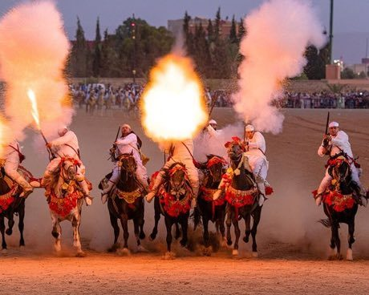

# Tbourida

*Tbourida / Fantasia · Moroccan horseback charge*

**Encyclopedia ID 164** (permanent) · https://equalinformation.com/world-heritage-games-site/games/164-tbourida/

*Photo: Houssain tork, [CC BY-SA 4.0](https://creativecommons.org/licenses/by-sa/4.0/), [source on Wikimedia Commons](https://commons.wikimedia.org/wiki/File:Moroccan_Tbourida_or_Fantasia.jpg)*

A line of riders gallops in formation and must fire their blank powder charges in one perfect volley on a signal, judged for unity.

## Heritage note

Part of the living heritage of Morocco. Animals are partners in this tradition; good care and local rules always come first. It is presented as sport and skill, never as real fighting.

## Origins

Usually placed in the era of Classical Worlds (about 1000 BCE to 500 CE), although its exact origins are uncertain, within the cultural world of Mediterranean.

## Facts

- **Where:** Morocco
- **Type:** Sports with animal partners
- **Family:** Horse and animal sports
- **Era:** [Classical Worlds](../../eras/classical/index.md) (uncertain)
- **Cradle:** [Mediterranean](../../cradles/mediterranean/index.md)
- **Region:** Middle East and North Africa

## Related entries

- [Slovene quintain](../../games/1073-slovene-quintain/index.md)
- [Cirit](../../games/156-cirit/index.md)
- [Equestrian vaulting](../../games/488-equestrian-vaulting/index.md)
- [Champ de Mars turf](../../games/1253-champ-de-mars-turf/index.md)
- [Encang kuda](../../games/1067-encang-kuda/index.md)
- [Turkmen Akhal-Teke equestrian games](../../games/1170-turkmen-akhal-teke-equestrian-games/index.md)

## Sources

- <https://commons.wikimedia.org/wiki/File:Moroccan_Tbourida_or_Fantasia.jpg>
