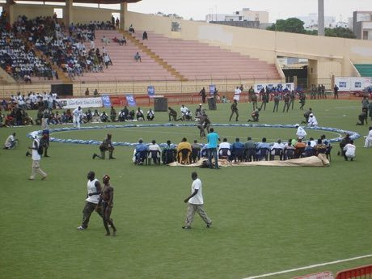

# Laamb Wrestling Bout

*Also known as: Laamb · Lutte*

**Encyclopedia ID 166** (permanent) · https://bpupadhyaya.github.io/world-heritage-games-site/games/166-laamb-wrestling-bout/

*Photo: KaBa (KaaBaa), [CC BY 3.0](https://creativecommons.org/licenses/by/3.0/), [source on Wikimedia Commons](https://commons.wikimedia.org/wiki/File:SenegaleseWrestling2.JPG)*

Two wrestlers grapple in a sand ring.

## Heritage note

Part of the living heritage of Senegal, Gambia. Some forms of this practice carry deep meaning for the communities who keep it; here we describe the play and the craft only, with respect for its roots.

## Origins

Usually placed in the era of River Valleys and First Cities (about 3000 to 1000 BCE), although its exact origins are uncertain, within the cultural world of Africa: Sahel, West and Central.

## Facts

- **Where:** Senegal, Gambia
- **Type:** Wrestling and martial sports
- **Family:** Wrestling
- **Era:** [River Valleys and First Cities](../../eras/river-valleys/index.md) (uncertain)
- **Cradle:** [Africa: Sahel, West and Central](../../cradles/africa-west/index.md)
- **Region:** Sub-Saharan Africa
- **Players:** 2

## Related entries

- [Traditional wrestling](../../games/619-traditional-wrestling/index.md)
- [Kokawa Hausa Wrestling](../../games/1316-kokawa-hausa-wrestling/index.md)
- [Kurash](../../games/253-kurash/index.md)
- [Kushti / Pehlwani mud wrestling](../../games/256-kushti-pehlwani-mud-wrestling/index.md)
- [Sumo bout](../../games/359-sumo-bout/index.md)
- [Ssireum](../../games/366-ssireum/index.md)

## Sources

- <https://commons.wikimedia.org/wiki/File:SenegaleseWrestling2.JPG>
- <https://www.senegal-online.com/la-culture-du-jeu-au-senegal-histoire-traditions-et-perspectives-davenir/>
