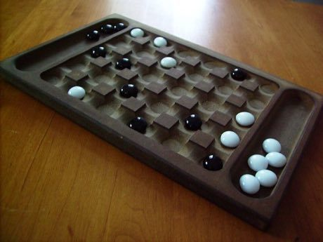

# Yote Capture Grid

*Also known as: Yoté*

**Encyclopedia ID 167** (permanent) · https://bpupadhyaya.github.io/world-heritage-games-site/games/167-yote-capture-grid/

*Photo: Esc861, [Public domain](https://creativecommons.org/publicdomain/mark/1.0/), [source on Wikimedia Commons](https://commons.wikimedia.org/wiki/File:Yote_board.JPG)*

Players drop 12 pieces one at a time onto a 5x6 grid, move one step, and jump an enemy to capture it plus a bonus second piece of choice taken from anywhere.

## Heritage note

Part of the living heritage of Senegal, Mali, Burkina Faso.

## Origins

Usually placed in the era of Crossroads and Golden Ages (about 500 to 1500), although its exact origins are uncertain, within the cultural world of Africa: Sahel, West and Central.

## Facts

- **Where:** Senegal, Mali, Burkina Faso
- **Type:** Board and table games
- **Family:** Draughts and capture games
- **Era:** [Crossroads and Golden Ages](../../eras/crossroads/index.md) (uncertain)
- **Cradle:** [Africa: Sahel, West and Central](../../cradles/africa-west/index.md)
- **Region:** Sub-Saharan Africa

## Play it

[Try a 90-second preview in your browser](https://bpupadhyaya.github.io/games-site/games/yote-capture-grid/play/) · [Google Play](https://play.google.com/store/apps/details?id=com.equalinformation.arcforge.shell) · [App Store](https://apps.apple.com/us/app/arcforge-world-heritage-games/id6813746442)

## Related entries

- [Queah](../../games/885-queah/index.md)
- [Dhamet](../../games/927-dhamet/index.md)
- [Turkish Dama](../../games/155-turkish-dama/index.md)
- [Peralikatuma](../../games/287-peralikatuma/index.md)
- [Kharbaga](../../games/459-kharbaga/index.md)
- [Sholo Guti](../../games/461-sholo-guti/index.md)

## Sources

- <https://commons.wikimedia.org/wiki/File:Yote_board.JPG>
