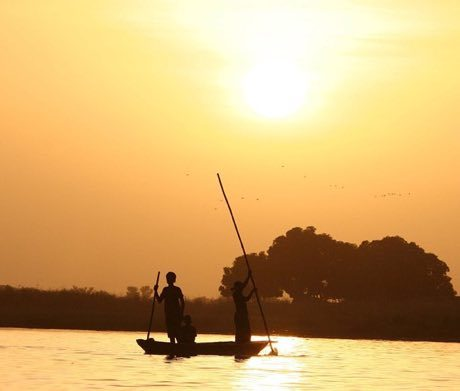

# Bozo Net Casting

*Also known as: Pêche à l'épervier (Bozo fishing)*

**Encyclopedia ID 169** (permanent) · https://bpupadhyaya.github.io/world-heritage-games-site/games/169-bozo-net-casting/

*Photo: Ferdinand Reuss, [CC BY 2.0](https://creativecommons.org/licenses/by/2.0/), [source on Wikimedia Commons](https://commons.wikimedia.org/wiki/File:Bozo_Fishermen.jpg)*

Stand in a canoe and swing a weighted circular net in a flick-and-spin so it opens fully over a shoal; choose river, season and depth.

## Heritage note

Part of the living heritage of Niger, Mali. Some forms of this practice carry deep meaning for the communities who keep it; here we describe the play and the craft only, with respect for its roots.

## Origins

Usually placed in the era of Modern Heritage (1800 to today), although its exact origins are uncertain, within the cultural world of Africa: Sahel, West and Central.

## Facts

- **Where:** Niger, Mali
- **Type:** Puzzles and mind games
- **Family:** Puzzle and dexterity toys
- **Era:** [Modern Heritage](../../eras/modern/index.md) (uncertain)
- **Cradle:** [Africa: Sahel, West and Central](../../cradles/africa-west/index.md)
- **Region:** Sub-Saharan Africa

## Play it

[Web preview](https://bpupadhyaya.github.io/) · [Google Play](https://play.google.com/store/apps/details?id=com.equalinformation.arcforge.shell) · [App Store](https://apps.apple.com/us/app/arcforge-world-heritage-games/id6813746442)

## Related entries

- [Akan Gold-Weight Balance](../../games/171-akan-gold-weight-balance/index.md)
- [Ampe](../../games/747-ampe/index.md)
- [Ten Ten](../../games/988-ten-ten/index.md)
- [Kingyo-sukui](../../games/3-kingyo-sukui/index.md)
- [Stone Skipping](../../games/5-stone-skipping/index.md)
- [Disc-flip](../../games/8-disc-flip/index.md)

## Sources

- <https://commons.wikimedia.org/wiki/File:Bozo_Fishermen.jpg>
