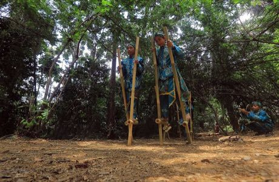

# Egrang

*Also known as: Ingkling · bamboo stilt race*

**Encyclopedia ID 17** (permanent) · https://bpupadhyaya.github.io/world-heritage-games-site/games/17-egrang/

*Photo: Djuli Pamungkas, [CC BY-SA 4.0](https://creativecommons.org/licenses/by-sa/4.0/), [source on Wikimedia Commons](https://commons.wikimedia.org/wiki/File:Egrang_Babakan_Siliwangi.jpg)*

Players walk on tall bamboo stilts across uneven ground, racing and sometimes bumping to unbalance rivals.

## Heritage note

Part of the living heritage of Indonesia, Malaysia.

## Origins

Usually placed in the era of Classical Worlds (about 1000 BCE to 500 CE), although its exact origins are uncertain, within the cultural world of Southeast Asia and the Islands.

## Facts

- **Where:** Indonesia, Malaysia
- **Type:** Racing
- **Family:** Puzzle and dexterity toys
- **Era:** [Classical Worlds](../../eras/classical/index.md) (uncertain)
- **Cradle:** [Southeast Asia and the Islands](../../cradles/southeast-asia/index.md)
- **Region:** East and Southeast Asia

## Play it

[Try a 90-second preview in your browser](https://bpupadhyaya.github.io/games-site/games/egrang/play/) · [Google Play](https://play.google.com/store/apps/details?id=com.equalinformation.arcforge.shell) · App Store (coming soon)

## Related entries

- [Tavern Nail and Wire Puzzles](../../games/110-tavern-nail-and-wire-puzzles/index.md)
- [Lato-lato](../../games/316-lato-lato/index.md)
- [Dougong Bracket Stacking](../../games/504-dougong-bracket-stacking/index.md)
- [Wayang Shadow Puppets](../../games/47-wayang-shadow-puppets/index.md)
- [Tinikling](../../games/141-tinikling/index.md)
- [Intha leg rowing on the lake](../../games/304-intha-leg-rowing-on-the-lake/index.md)

## Sources

- <https://commons.wikimedia.org/wiki/File:Egrang_Babakan_Siliwangi.jpg>
