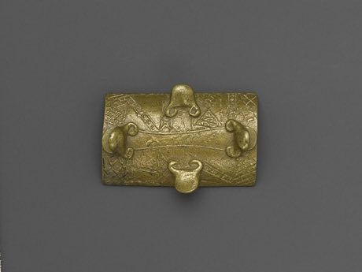

# Akan Gold-Weight Balance

*Also known as: Abrammuo · goldweights*

**Encyclopedia ID 171** (permanent) · https://bpupadhyaya.github.io/world-heritage-games-site/games/171-akan-gold-weight-balance/

*Photo: Brooklyn Museum (unknown maker), [CC BY 3.0](https://creativecommons.org/licenses/by/3.0/), [source on Wikimedia Commons](https://commons.wikimedia.org/wiki/File:Brooklyn_Museum_74.218.29_Gold_Weight.jpg)*

Use a brass pan balance and a set of small cast figure weights to measure out gold dust for each customer's order within the fewest weighings.

## Heritage note

Part of the living heritage of Ghana, Cote d'Ivoire.

## Origins

Usually placed in the era of Modern Heritage (1800 to today), although its exact origins are uncertain, within the cultural world of Africa: Sahel, West and Central.

## Facts

- **Where:** Ghana, Cote d'Ivoire
- **Type:** Puzzles and mind games
- **Family:** Puzzle and dexterity toys
- **Era:** [Modern Heritage](../../eras/modern/index.md) (uncertain)
- **Cradle:** [Africa: Sahel, West and Central](../../cradles/africa-west/index.md)
- **Region:** Sub-Saharan Africa

## Related entries

- [Ampe](../../games/747-ampe/index.md)
- [Bozo Net Casting](../../games/169-bozo-net-casting/index.md)
- [Ten Ten](../../games/988-ten-ten/index.md)
- [Kingyo-sukui](../../games/3-kingyo-sukui/index.md)
- [Stone Skipping](../../games/5-stone-skipping/index.md)
- [Disc-flip](../../games/8-disc-flip/index.md)

## Sources

- <https://commons.wikimedia.org/wiki/File:Brooklyn_Museum_74.218.29_Gold_Weight.jpg>
