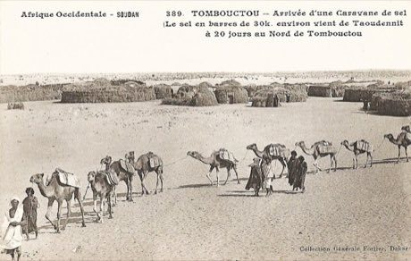

# Sahel Salt Caravan

*Azalai (Taoudenni to Timbuktu)*

**Encyclopedia ID 172** (permanent) · https://equalinformation.com/world-heritage-games-site/games/172-sahel-salt-caravan/

*Photo: François-Edmond Fortier, [Public domain](https://creativecommons.org/publicdomain/mark/1.0/), [source on Wikimedia Commons](https://commons.wikimedia.org/wiki/File:Tombouctou-Arrivée_d'une_caravane_de_sel_(AOF).jpg)*

Lead a camel train across the Sahara to the Timbuktu market, choosing wells, rest days and loads to arrive with the most salt slabs.

## Heritage note

Part of the living heritage of Niger, Mali.

## Origins

Usually placed in the era of Crossroads and Golden Ages (about 500 to 1500), although its exact origins are uncertain, within the cultural world of Africa: Sahel, West and Central.

## Facts

- **Where:** Niger, Mali
- **Type:** Sports with animal partners
- **Family:** Horse and animal sports
- **Era:** [Crossroads and Golden Ages](../../eras/crossroads/index.md) (uncertain)
- **Cradle:** [Africa: Sahel, West and Central](../../cradles/africa-west/index.md)
- **Region:** Sub-Saharan Africa

## Related entries

- [Lake Assal salt harvest](../../games/1321-lake-assal-salt-harvest/index.md)
- [Yote Capture Grid](../../games/167-yote-capture-grid/index.md)
- [Wave riding](../../games/76-wave-riding/index.md)
- [Cirit](../../games/156-cirit/index.md)
- [Tbourida](../../games/164-tbourida/index.md)
- [Equestrian vaulting](../../games/488-equestrian-vaulting/index.md)

## Sources

- <https://commons.wikimedia.org/wiki/File:Tombouctou-Arrivée_d'une_caravane_de_sel_(AOF).jpg>
