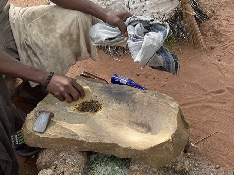

# Krobo Powder-Glass Beads

*Krobo beads*

**Encyclopedia ID 173** (permanent) · https://equalinformation.com/world-heritage-games-site/games/173-krobo-powder-glass-beads/

*Photo: Warmglow, [CC BY-SA 4.0](https://creativecommons.org/licenses/by-sa/4.0/), [source on Wikimedia Commons](https://commons.wikimedia.org/wiki/File:Krobo_glass_bead_making,_crushed_glass_for_beads_02.jpg)*

Fill a clay mould with crushed glass in colour layers, fire it and string the finished beads to match a design brief.

## Heritage note

Part of the living heritage of Ghana. Some forms of this practice carry deep meaning for the communities who keep it; here we describe the play and the craft only, with respect for its roots.

## Origins

A living tradition passed from person to person; it is not tied to a single dated origin. It belongs to the cultural world of Africa: Sahel, West and Central.

## Facts

- **Where:** Ghana
- **Type:** Crafts and making
- **Family:** Pottery, wood and metal crafts
- **Era:** [Living Traditions](../../eras/living/index.md)
- **Cradle:** [Africa: Sahel, West and Central](../../cradles/africa-west/index.md)
- **Region:** Sub-Saharan Africa

## Related entries

- [Kissi Penny Forging](../../games/1314-kissi-penny-forging/index.md)
- [Tuareg Tea](../../games/1390-tuareg-tea/index.md)
- [Zellij tile mosaic](../../games/21-zellij-tile-mosaic/index.md)
- [Swahili carved door](../../games/90-swahili-carved-door/index.md)
- [Thai fruit and vegetable carving](../../games/114-thai-fruit-and-vegetable-carving/index.md)
- [Glassblowing](../../games/121-glassblowing/index.md)

## Sources

- <https://commons.wikimedia.org/wiki/File:Krobo_glass_bead_making,_crushed_glass_for_beads_02.jpg>
