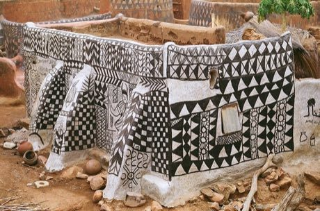

# Tiebele House Painting

*Tiébélé*

**Encyclopedia ID 174** (permanent) · https://equalinformation.com/world-heritage-games-site/games/174-tiebele-house-painting/

*Photo: Alexander Leisser, [CC BY-SA 4.0](https://creativecommons.org/licenses/by-sa/4.0/), [source on Wikimedia Commons](https://commons.wikimedia.org/wiki/File:Tiebele_village_in_Burkina_Faso_04.jpg)*

Mix earth pigments and paint black-and-white geometric bands on a mud wall following the symmetry of a pattern brief, then handle rain by repairing.

## Heritage note

Part of the living heritage of Burkina Faso.

## Origins

A living tradition passed from person to person; it is not tied to a single dated origin. It belongs to the cultural world of Africa: Sahel, West and Central.

## Facts

- **Where:** Burkina Faso
- **Type:** Crafts and making
- **Family:** Paper, ink and painting crafts
- **Era:** [Living Traditions](../../eras/living/index.md)
- **Cradle:** [Africa: Sahel, West and Central](../../cradles/africa-west/index.md)
- **Region:** Sub-Saharan Africa

## Related entries

- [Bogolan mud cloth](../../games/86-bogolan-mud-cloth/index.md)
- [Kuba cloth pattern puzzle](../../games/91-kuba-cloth-pattern-puzzle/index.md)
- [Adinkra Cloth Stamping](../../games/170-adinkra-cloth-stamping/index.md)
- [Asafo Flag Appliqué](../../games/1230-asafo-flag-applique/index.md)
- [Dahomey Appliqué Panel Studio](../../games/1262-dahomey-applique-panel-studio/index.md)
- [Dakar Car Rapide Livery Painter](../../games/1263-dakar-car-rapide-livery-painter/index.md)

## Sources

- <https://commons.wikimedia.org/wiki/File:Tiebele_village_in_Burkina_Faso_04.jpg>
