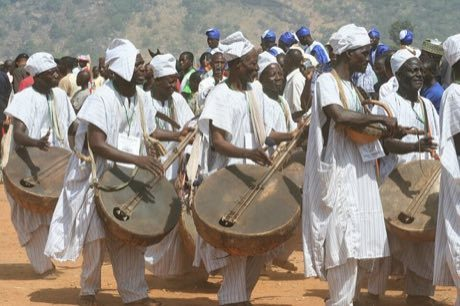

# Goje One-String Fiddle

*Goge / goje*

**Encyclopedia ID 176** (permanent) · https://equalinformation.com/world-heritage-games-site/games/176-goje-one-string-fiddle/

*Photo: Gogeafrica, [CC BY-SA 4.0](https://creativecommons.org/licenses/by-sa/4.0/), [source on Wikimedia Commons](https://commons.wikimedia.org/wiki/File:Goje_players_from_Northen_Nigeria.jpg)*

Bow a single string over a gourd body while pressing the fingers on the neck to follow a Hausa-style melody and accompany a drum loop.

## Heritage note

Part of the living heritage of Nigeria, Niger.

## Origins

A living tradition passed from person to person; it is not tied to a single dated origin. It belongs to the cultural world of Africa: Sahel, West and Central.

## Facts

- **Where:** Nigeria, Niger
- **Type:** Musical instruments
- **Family:** String instruments
- **Era:** [Living Traditions](../../eras/living/index.md)
- **Cradle:** [Africa: Sahel, West and Central](../../cradles/africa-west/index.md)
- **Region:** Sub-Saharan Africa

## Related entries

- [Santur Hammer Strings](../../games/138-santur-hammer-strings/index.md)
- [Dan bau](../../games/143-dan-bau/index.md)
- [Santoor](../../games/151-santoor/index.md)
- [Masenqo and the azmari](../../games/187-masenqo-and-the-azmari/index.md)
- [Hira gasy village troupe contest](../../games/205-hira-gasy-village-troupe-contest/index.md)
- [Phuang malai flower garland threading](../../games/309-phuang-malai-flower-garland-threading/index.md)

## Sources

- <https://commons.wikimedia.org/wiki/File:Goje_players_from_Northen_Nigeria.jpg>
