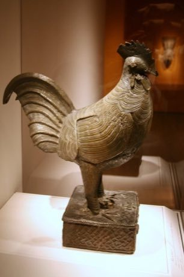

# Lost-Wax Bronze Casting

*Igun / lost-wax casting*

**Encyclopedia ID 178** (permanent) · https://equalinformation.com/world-heritage-games-site/games/178-lost-wax-bronze-casting/

*Photo: cliff1066, [CC BY 2.0](https://creativecommons.org/licenses/by/2.0/), [source on Wikimedia Commons](https://commons.wikimedia.org/wiki/File:Edo_rooster.jpg)*

Sculpt a wax model, coat it in clay, melt the wax out, pour molten metal at the right temperature and break the mould to reveal the form.

## Heritage note

Part of the living heritage of Japan, Benin, Nigeria. Some forms of this practice carry deep meaning for the communities who keep it; here we describe the play and the craft only, with respect for its roots.

## Origins

A living tradition passed from person to person; it is not tied to a single dated origin. It belongs to the cultural world of Japan and Korea.

## Facts

- **Where:** Japan, Benin, Nigeria
- **Type:** Crafts and making
- **Family:** Pottery, wood and metal crafts
- **Era:** [Living Traditions](../../eras/living/index.md)
- **Cradle:** [Japan and Korea](../../cradles/japan-korea/index.md)
- **Region:** East and Southeast Asia

## Related entries

- [Leaded Glass Window Making](../../games/501-leaded-glass-window-making/index.md)
- [Ukiyo-e Woodblock Printing](../../games/1490-ukiyo-e-woodblock-printing/index.md)
- [Goryeo Celadon Inlay](../../games/1455-goryeo-celadon-inlay/index.md)
- [Zellij tile mosaic](../../games/21-zellij-tile-mosaic/index.md)
- [Swahili carved door](../../games/90-swahili-carved-door/index.md)
- [Thai fruit and vegetable carving](../../games/114-thai-fruit-and-vegetable-carving/index.md)

## Sources

- <https://commons.wikimedia.org/wiki/File:Edo_rooster.jpg>
