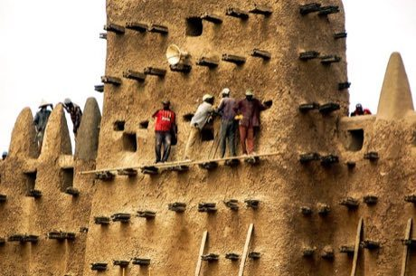

# Mud Plaster Season

*Crepissage (Sahel earth building)*

**Encyclopedia ID 179** (permanent) · https://equalinformation.com/world-heritage-games-site/games/179-mud-plaster-season/

*Photo: Ralf Steinberger, [CC BY 2.0](https://creativecommons.org/licenses/by/2.0/), [source on Wikimedia Commons](https://commons.wikimedia.org/wiki/File:Annual_repair_of_the_world's_largest_mud_brick_building_the_Great_Mosque_of_Djenné_in_Mali._(32088227574).jpg)*

Mix mud plaster and climb the toron-beam scaffolds to re-coat a tall earthen wall before the rains, with team coordination on sections.

## Heritage note

Part of the living heritage of Mali. Some forms of this practice carry deep meaning for the communities who keep it; here we describe the play and the craft only, with respect for its roots.

## Origins

A living tradition passed from person to person; it is not tied to a single dated origin. It belongs to the cultural world of Africa: Sahel, West and Central.

## Facts

- **Where:** Mali
- **Type:** Crafts and making
- **Era:** [Living Traditions](../../eras/living/index.md)
- **Cradle:** [Africa: Sahel, West and Central](../../cradles/africa-west/index.md)
- **Region:** Sub-Saharan Africa

## Related entries

- [Bogolan mud cloth](../../games/86-bogolan-mud-cloth/index.md)
- [Dogon Granary Builder](../../games/177-dogon-granary-builder/index.md)
- [Kente strip weaving](../../games/22-kente-strip-weaving/index.md)
- [Talking drum](../../games/33-talking-drum/index.md)
- [Adire indigo resist dyeing](../../games/87-adire-indigo-resist-dyeing/index.md)
- [Kuba cloth pattern puzzle](../../games/91-kuba-cloth-pattern-puzzle/index.md)

## Sources

- <https://commons.wikimedia.org/wiki/File:Annual_repair_of_the_world's_largest_mud_brick_building_the_Great_Mosque_of_Djenné_in_Mali._(32088227574).jpg>
