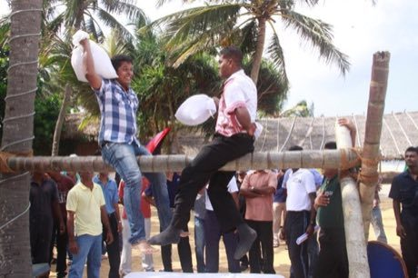

# Kotta Pora

*කොට්ටා පොර · pillow fight on a log*

**Encyclopedia ID 18** (permanent) · https://equalinformation.com/world-heritage-games-site/games/18-kotta-pora/

*Photo: YaSiRu11, [CC BY-SA 4.0](https://creativecommons.org/licenses/by-sa/4.0/), [source on Wikimedia Commons](https://commons.wikimedia.org/wiki/File:Kotta-Pora.jpg)*

Two players sit astride a greased log over a pit and swing pillows, trying to knock the opponent off balance.

## Heritage note

Part of the living heritage of Sri Lanka. It is presented as sport and skill, never as real fighting.

## Origins

Usually placed in the era of Classical Worlds (about 1000 BCE to 500 CE), although its exact origins are uncertain, within the cultural world of South Asia.

## Facts

- **Where:** Sri Lanka
- **Type:** Wrestling and martial sports
- **Era:** [Classical Worlds](../../eras/classical/index.md) (uncertain)
- **Cradle:** [South Asia](../../cradles/south-asia/index.md)
- **Region:** South and Central Asia

## Related entries

- [Stilt fishing](../../games/288-stilt-fishing/index.md)
- [Horn pulling](../../games/1103-horn-pulling/index.md)
- [Kathputli string puppets](../../games/79-kathputli-string-puppets/index.md)
- [Silambam](../../games/271-silambam/index.md)
- [Murchunga](../../games/290-murchunga/index.md)
- [Lathi Khela](../../games/298-lathi-khela/index.md)

## Sources

- <https://commons.wikimedia.org/wiki/File:Kotta-Pora.jpg>
