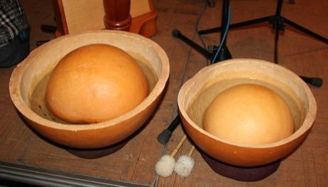

# Calabash Water Drum

*Water drum (tinde / water calabashes)*

**Encyclopedia ID 180** (permanent) · https://bpupadhyaya.github.io/world-heritage-games-site/games/180-calabash-water-drum/

*Photo: de:Benutzer:Smalltown Boy, Free use (Wikimedia Commons licence template), [source on Wikimedia Commons](https://commons.wikimedia.org/wiki/File:Wassertrommeln.jpg)*

Half-gourds float in water basins and strike different areas with soft mallets, lifting and sinking to change pitch and echo in rhythm patterns.

## Heritage note

Part of the living heritage of Niger, Nigeria. Some forms of this practice carry deep meaning for the communities who keep it; here we describe the play and the craft only, with respect for its roots.

## Origins

A living tradition passed from person to person; it is not tied to a single dated origin. It belongs to the cultural world of Africa: Sahel, West and Central.

## Facts

- **Where:** Niger, Nigeria
- **Type:** Musical instruments
- **Family:** Drums and percussion
- **Era:** [Living Traditions](../../eras/living/index.md)
- **Cradle:** [Africa: Sahel, West and Central](../../cradles/africa-west/index.md)
- **Region:** Sub-Saharan Africa

## Related entries

- [Talking drum](../../games/33-talking-drum/index.md)
- [Batuque Cloth-Drum Circle](../../games/1251-batuque-cloth-drum-circle/index.md)
- [Marimba](../../games/52-marimba/index.md)
- [Amadinda and embaire](../../games/185-amadinda-and-embaire/index.md)
- [Tombak goblet drum rhythms](../../games/233-tombak-goblet-drum-rhythms/index.md)
- [Dhol drum rhythm](../../games/263-dhol-drum-rhythm/index.md)

## Sources

- <https://commons.wikimedia.org/wiki/File:Wassertrommeln.jpg>
