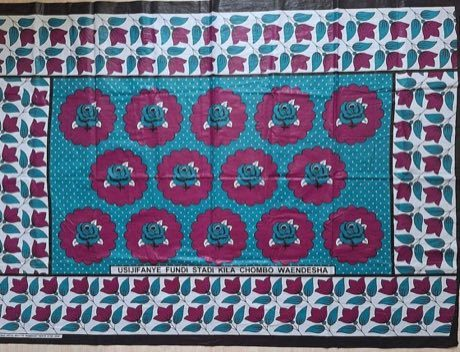

# Kanga cloth design

*Also known as: Kanga · leso*

**Encyclopedia ID 184** (permanent) · https://bpupadhyaya.github.io/world-heritage-games-site/games/184-kanga-cloth-design/

*Photo: Avocado isl, [CC BY-SA 4.0](https://creativecommons.org/licenses/by-sa/4.0/), [source on Wikimedia Commons](https://commons.wikimedia.org/wiki/File:Kanga_leso_Kenya_01.jpg)*

Assemble a kanga: pick border, central motif and a short Swahili saying printed along the bottom, matching pattern pieces to a given mood or occasion.

## Heritage note

Part of the living heritage of Kenya. Some forms of this practice carry deep meaning for the communities who keep it; here we describe the play and the craft only, with respect for its roots.

## Origins

A living tradition passed from person to person; it is not tied to a single dated origin. It belongs to the cultural world of Africa: Great Lakes and Indian Ocean.

## Facts

- **Where:** Kenya
- **Type:** Crafts and making
- **Family:** Paper, ink and painting crafts
- **Era:** [Living Traditions](../../eras/living/index.md)
- **Cradle:** [Africa: Great Lakes and Indian Ocean](../../cradles/africa-east/index.md)
- **Region:** Sub-Saharan Africa

## Related entries

- [Imigongo geometric painting](../../games/182-imigongo-geometric-painting/index.md)
- [Tingatinga painting](../../games/183-tingatinga-painting/index.md)
- [Antaimoro flower paper](../../games/1229-antaimoro-flower-paper/index.md)
- [Ebru paper marbling](../../games/20-ebru-paper-marbling/index.md)
- [Ndebele geometric wall painting](../../games/23-ndebele-geometric-wall-painting/index.md)
- [Chinese knotting](../../games/26-chinese-knotting/index.md)

## Sources

- <https://commons.wikimedia.org/wiki/File:Kanga_leso_Kenya_01.jpg>
