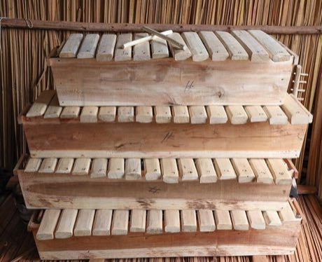

# Amadinda and embaire

*Also known as: Amadinda · log xylophone duet*

**Encyclopedia ID 185** (permanent) · https://bpupadhyaya.github.io/world-heritage-games-site/games/185-amadinda-and-embaire/

*Photo: Ssemmanda will, [CC BY-SA 4.0](https://creativecommons.org/licenses/by-sa/4.0/), [source on Wikimedia Commons](https://commons.wikimedia.org/wiki/File:Melodies_in_Wood,_Traditional_Ugandan_Xylophones.jpg)*

Two players on one xylophone interlock: one plays a steady pattern, the other fills the gaps.

## Heritage note

Part of the living heritage of Uganda. Some forms of this practice carry deep meaning for the communities who keep it; here we describe the play and the craft only, with respect for its roots.

## Origins

A living tradition passed from person to person; it is not tied to a single dated origin. It belongs to the cultural world of Africa: Great Lakes and Indian Ocean.

## Facts

- **Where:** Uganda
- **Type:** Musical instruments
- **Family:** Drums and percussion
- **Era:** [Living Traditions](../../eras/living/index.md)
- **Cradle:** [Africa: Great Lakes and Indian Ocean](../../cradles/africa-east/index.md)
- **Region:** Sub-Saharan Africa

## Related entries

- [Burundian drum ensemble](../../games/1250-burundian-drum-ensemble/index.md)
- [Namalwa friction drum](../../games/7919-namalwa-friction-drum/index.md)
- [Silimba](../../games/7920-silimba/index.md)
- [Kamba musya bell dance](../../games/17976-kamba-musya-bell-dance/index.md)
- [Kankobele](../../games/18085-kankobele/index.md)
- [Talking drum](../../games/33-talking-drum/index.md)

## Sources

- <https://commons.wikimedia.org/wiki/File:Melodies_in_Wood,_Traditional_Ugandan_Xylophones.jpg>
