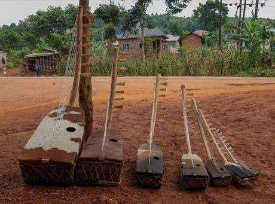

# Adungu

*Also known as: arched harp*

**Encyclopedia ID 186** (permanent) · https://bpupadhyaya.github.io/world-heritage-games-site/games/186-adungu/

*Photo: Ssemmanda will, [CC BY-SA 4.0](https://creativecommons.org/licenses/by-sa/4.0/), [source on Wikimedia Commons](https://commons.wikimedia.org/wiki/File:Several_adungu_(bow_harps)_displayed_outdoors_in_Uganda.jpg)*

Pluck the strings of a bow harp in time with falling notes in the pentatonic scale and add a drum bass voice.

## Heritage note

Part of the living heritage of Uganda. Some forms of this practice carry deep meaning for the communities who keep it; here we describe the play and the craft only, with respect for its roots.

## Origins

Usually placed in the era of Classical Worlds (about 1000 BCE to 500 CE), although its exact origins are uncertain, within the cultural world of Africa: Great Lakes and Indian Ocean.

## Facts

- **Where:** Uganda
- **Type:** Musical instruments
- **Family:** String instruments
- **Era:** [Classical Worlds](../../eras/classical/index.md) (uncertain)
- **Cradle:** [Africa: Great Lakes and Indian Ocean](../../cradles/africa-east/index.md)
- **Region:** Sub-Saharan Africa

## Related entries

- [Valiha tube zither](../../games/124-valiha-tube-zither/index.md)
- [Nyatiti Luo lyre](../../games/1349-nyatiti-luo-lyre/index.md)
- [Morin khuur](../../games/34-morin-khuur/index.md)
- [String Marionette Theatre](../../games/68-string-marionette-theatre/index.md)
- [Kathputli string puppets](../../games/79-kathputli-string-puppets/index.md)
- [Krar lyre](../../games/126-krar-lyre/index.md)

## Sources

- <https://commons.wikimedia.org/wiki/File:Several_adungu_(bow_harps)_displayed_outdoors_in_Uganda.jpg>
