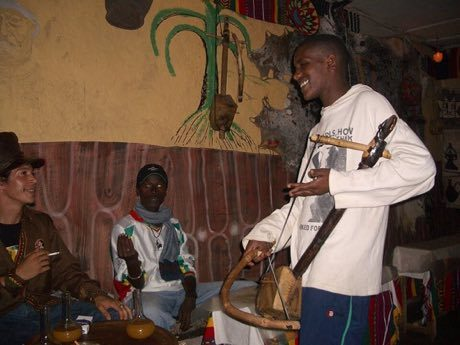

# Masenqo and the azmari

*Also known as: Masinko · masenqo · one-string fiddle*

**Encyclopedia ID 187** (permanent) · https://bpupadhyaya.github.io/world-heritage-games-site/games/187-masenqo-and-the-azmari/

*Photo: Flickr user meg and rahul, [CC BY 2.0](https://creativecommons.org/licenses/by/2.0/), [source on Wikimedia Commons](https://commons.wikimedia.org/wiki/File:Azmari_in_a_tejbeit.jpg)*

Bow a single string while sliding a finger to follow a melody path, matching Ethiopian pentatonic modes, then add short improvised rhymes between phrases.

## Heritage note

Part of the living heritage of Ethiopia.

## Origins

A living tradition passed from person to person; it is not tied to a single dated origin. It belongs to the cultural world of Africa: Nile and the Horn.

## Facts

- **Where:** Ethiopia
- **Type:** Musical instruments
- **Family:** String instruments
- **Era:** [Living Traditions](../../eras/living/index.md)
- **Cradle:** [Africa: Nile and the Horn](../../cradles/africa-nile/index.md)
- **Region:** Sub-Saharan Africa

## Related entries

- [Krar lyre](../../games/126-krar-lyre/index.md)
- [Santur Hammer Strings](../../games/138-santur-hammer-strings/index.md)
- [Dan bau](../../games/143-dan-bau/index.md)
- [Santoor](../../games/151-santoor/index.md)
- [Goje One-String Fiddle](../../games/176-goje-one-string-fiddle/index.md)
- [Hira gasy village troupe contest](../../games/205-hira-gasy-village-troupe-contest/index.md)

## Sources

- <https://commons.wikimedia.org/wiki/File:Azmari_in_a_tejbeit.jpg>
