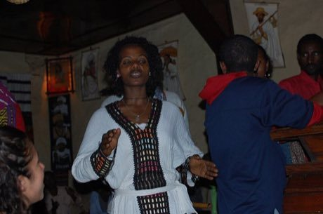

# Eskista

*Eskista · Ethiopian shoulder dance*

**Encyclopedia ID 188** (permanent) · https://bpupadhyaya.github.io/world-heritage-games-site/games/188-eskista/

*Photo: Katie Hunt, [CC BY 2.0](https://creativecommons.org/licenses/by/2.0/), [source on Wikimedia Commons](https://commons.wikimedia.org/wiki/File:Nightlife_at_the_Balageru_Cultural_Centre,_Bahir_Dar_(5494874936).jpg)*

Follow beat cues to roll, shake and snap the shoulders and chest in time with drum patterns.

## Heritage note

Part of the living heritage of Ethiopia.

## Origins

A living tradition passed from person to person; it is not tied to a single dated origin. It belongs to the cultural world of Africa: Nile and the Horn.

## Facts

- **Where:** Ethiopia
- **Type:** Dances
- **Family:** Folk and line dances
- **Era:** [Living Traditions](../../eras/living/index.md)
- **Cradle:** [Africa: Nile and the Horn](../../cradles/africa-nile/index.md)
- **Region:** Sub-Saharan Africa

## Related entries

- [Jebena coffee brewing](../../games/189-jebena-coffee-brewing/index.md)
- [Tahtib](../../games/157-tahtib/index.md)
- [Dabke line dance](../../games/37-dabke-line-dance/index.md)
- [Gumboot dance rhythm](../../games/123-gumboot-dance-rhythm/index.md)
- [Cueca](../../games/430-cueca/index.md)
- [Faroese chain dance](../../games/1276-faroese-chain-dance/index.md)

## Sources

- <https://commons.wikimedia.org/wiki/File:Nightlife_at_the_Balageru_Cultural_Centre,_Bahir_Dar_(5494874936).jpg>
