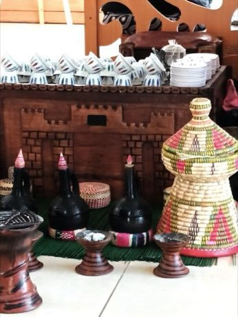

# Jebena coffee brewing

*Buna / jebena*

**Encyclopedia ID 189** (permanent) · https://bpupadhyaya.github.io/world-heritage-games-site/games/189-jebena-coffee-brewing/

*Photo: Miraethiopia, [CC BY-SA 4.0](https://creativecommons.org/licenses/by-sa/4.0/), [source on Wikimedia Commons](https://commons.wikimedia.org/wiki/File:Ethiopian_coffee_ceremony_jebena_and_finjan.jpg)*

Roast, grind, boil in the clay jebena and pour in one continuous stream into small cups, timing each step by sight, sound and smell cues.

## Heritage note

Part of the living heritage of Ethiopia, Eritrea. Some forms of this practice carry deep meaning for the communities who keep it; here we describe the play and the craft only, with respect for its roots.

## Origins

A living tradition passed from person to person; it is not tied to a single dated origin. It belongs to the cultural world of Africa: Nile and the Horn.

## Facts

- **Where:** Ethiopia, Eritrea
- **Type:** Crafts and making
- **Family:** Folk and line dances
- **Era:** [Living Traditions](../../eras/living/index.md)
- **Cradle:** [Africa: Nile and the Horn](../../cradles/africa-nile/index.md)
- **Region:** Sub-Saharan Africa

## Related entries

- [Eskista](../../games/188-eskista/index.md)
- [Tahtib](../../games/157-tahtib/index.md)
- [Dabke line dance](../../games/37-dabke-line-dance/index.md)
- [Gumboot dance rhythm](../../games/123-gumboot-dance-rhythm/index.md)
- [Cueca](../../games/430-cueca/index.md)
- [Faroese chain dance](../../games/1276-faroese-chain-dance/index.md)

## Sources

- <https://commons.wikimedia.org/wiki/File:Ethiopian_coffee_ceremony_jebena_and_finjan.jpg>
