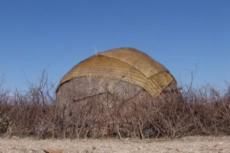

# Aqal Somali

*Also known as: Aqal Soomaali · nomad hut building*

**Encyclopedia ID 190** (permanent) · https://bpupadhyaya.github.io/world-heritage-games-site/games/190-aqal-somali/

*Photo: Charles Roffey, [CC BY-SA 3.0](https://creativecommons.org/licenses/by-sa/3.0/), [source on Wikimedia Commons](https://commons.wikimedia.org/wiki/File:Somali_aqal.jpg)*

Bend arched poles, lash them and cover the frame with woven mats in the right order so the portable hut stands before the day ends.

## Heritage note

Part of the living heritage of Somalia. Some forms of this practice carry deep meaning for the communities who keep it; here we describe the play and the craft only, with respect for its roots.

## Origins

A living tradition passed from person to person; it is not tied to a single dated origin. It belongs to the cultural world of Africa: Nile and the Horn.

## Facts

- **Where:** Somalia
- **Type:** Crafts and making
- **Era:** [Living Traditions](../../eras/living/index.md)
- **Cradle:** [Africa: Nile and the Horn](../../cradles/africa-nile/index.md)
- **Region:** Sub-Saharan Africa

## Related entries

- [Tahtib](../../games/157-tahtib/index.md)
- [Masenqo and the azmari](../../games/187-masenqo-and-the-azmari/index.md)
- [Eskista](../../games/188-eskista/index.md)
- [Jebena coffee brewing](../../games/189-jebena-coffee-brewing/index.md)
- [Nubian house painting](../../games/192-nubian-house-painting/index.md)
- [Khayamiya Tentmaker Applique](../../games/217-khayamiya-tentmaker-applique/index.md)

## Sources

- <https://commons.wikimedia.org/wiki/File:Somali_aqal.jpg>
