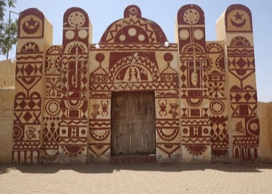

# Nubian house painting

*Also known as: Nuba · Nubian wall decoration*

**Encyclopedia ID 192** (permanent) · https://bpupadhyaya.github.io/world-heritage-games-site/games/192-nubian-house-painting/

*Photo: Ola A. Alsheikh, [CC BY-SA 4.0](https://creativecommons.org/licenses/by-sa/4.0/), [source on Wikimedia Commons](https://commons.wikimedia.org/wiki/File:Traditional_Nubian_wall_painting.jpg)*

Decorate the wall of a house with repeating bands of geometric symbols in red, black, white and ochre, matching a pattern reference.

## Heritage note

Part of the living heritage of Egypt.

## Origins

A living tradition passed from person to person; it is not tied to a single dated origin. It belongs to the cultural world of Africa: Nile and the Horn.

## Facts

- **Where:** Egypt
- **Type:** Crafts and making
- **Family:** Paper, ink and painting crafts
- **Era:** [Living Traditions](../../eras/living/index.md)
- **Cradle:** [Africa: Nile and the Horn](../../cradles/africa-nile/index.md)
- **Region:** Middle East and North Africa

## Related entries

- [Mashrabiya Lattice Joinery](../../games/214-mashrabiya-lattice-joinery/index.md)
- [Khayamiya Tentmaker Applique](../../games/217-khayamiya-tentmaker-applique/index.md)
- [Dinka beaded corset beadwork](../../games/1269-dinka-beaded-corset-beadwork/index.md)
- [Ebru paper marbling](../../games/20-ebru-paper-marbling/index.md)
- [Ndebele geometric wall painting](../../games/23-ndebele-geometric-wall-painting/index.md)
- [Chinese knotting](../../games/26-chinese-knotting/index.md)

## Sources

- <https://commons.wikimedia.org/wiki/File:Traditional_Nubian_wall_painting.jpg>
